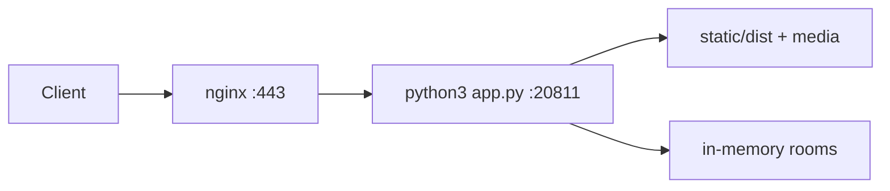

# Deploy GensokyoGeoGuesser Neo

This guide describes how to deploy the app as a long-running service on this machine.

## Overview

- Backend: Flask app from `app.py`
- Frontend: built by Vite into `static/dist`
- Runtime state: in-memory only (single process)
- Production app port: `20811` (localhost), exposed through nginx on `80/443`

Important: do not use multi-worker WSGI process models for this app. Run a single Flask process.

## Prerequisites

- Python 3.8+ with `python3-venv` (`sudo apt install python3-venv`)
- Node.js and `npm` (build-time only)
- `nginx`
- DNS A/AAAA record: `ggg-neo.arthas.org` points to this server
- Open firewall for `80` and `443`

> **Note on PEP 668 (Debian/Ubuntu):** System Python on Debian 12+ and Ubuntu 24.04+ blocks
> `pip install` system-wide by default. `install.sh` handles this automatically by creating a
> virtualenv at `.venv/` inside the repo directory.

## 1) Build and install app dependencies

```bash
cd /home/priv/apps/GensokyoGeoGuesser
./install.sh
```

What `install.sh` does:

1. Creates a virtualenv at `.venv/` (skipped if it already exists)
2. Installs Python dependencies from `requirements.txt` into the venv
3. Installs frontend dependencies in `frontend/`
4. Copies assets from `data/` into `static/`
5. Builds frontend into `static/dist`
6. Verifies dataset integrity

The virtualenv interpreter is at `.venv/bin/python`. All subsequent steps use this path.

`install.sh` uses the Aliyun PyPI mirror by default (`https://mirrors.aliyun.com/pypi/simple/`).
Override with `PIP_INDEX_URL` if needed:

```bash
PIP_INDEX_URL=https://pypi.tuna.tsinghua.edu.cn/simple ./install.sh
```

Optional smoke test:

```bash
cd /home/priv/apps/GensokyoGeoGuesser
.venv/bin/python app.py --port 20811
```

Then open `http://127.0.0.1:20811/lobby` from the server.

## 2) Create systemd service (port 20811)

Use the included unit file:

- Source: `docs/deploy/ggg-neo.service`
- Target: `/etc/systemd/system/ggg-neo.service`

Install and start:

```bash
sudo cp /home/priv/apps/GensokyoGeoGuesser/docs/deploy/ggg-neo.service /etc/systemd/system/ggg-neo.service
sudo systemctl daemon-reload
sudo systemctl enable --now ggg-neo
sudo systemctl status ggg-neo
```

Useful commands:

```bash
sudo systemctl restart ggg-neo
sudo journalctl -u ggg-neo -f
```

## 3) Configure nginx reverse proxy

Use the included nginx site file:

- Source: `docs/deploy/nginx-ggg-neo.conf`
- Target: `/etc/nginx/sites-available/ggg-neo.arthas.org`

Enable site:

```bash
sudo cp /home/priv/apps/GensokyoGeoGuesser/docs/deploy/nginx-ggg-neo.conf /etc/nginx/sites-available/ggg-neo.arthas.org
sudo ln -s /etc/nginx/sites-available/ggg-neo.arthas.org /etc/nginx/sites-enabled/ggg-neo.arthas.org
sudo nginx -t
sudo systemctl reload nginx
```

Notes:

- The proxy points to `http://127.0.0.1:20811`.
- SSE endpoints (`/events/...`) require buffering disabled and long read timeout.

## 4) Obtain HTTPS certificate with certbot

Install certbot + nginx plugin:

```bash
sudo apt update
sudo apt install -y certbot python3-certbot-nginx
```

Issue certificate:

```bash
sudo certbot --nginx -d ggg-neo.arthas.org
```

Certbot will update nginx config and add HTTPS server blocks automatically.

Check auto-renew:

```bash
sudo systemctl status certbot.timer
sudo certbot renew --dry-run
```

## 5) Post-deploy verification

- Open `https://ggg-neo.arthas.org/lobby`
- Create/join a room and verify gameplay starts
- Check service logs if needed:
  - `sudo journalctl -u ggg-neo -n 200`
  - `sudo tail -n 200 /var/log/nginx/error.log`

## 6) Update workflow

After pulling new code:

```bash
cd /home/priv/apps/GensokyoGeoGuesser
./install.sh        # re-uses existing .venv; installs any new deps
sudo systemctl restart ggg-neo
```

## Traffic architecture



