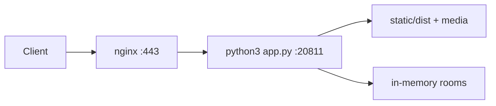

# Deploy GensokyoGeoGuesser Neo

This guide describes how to deploy the app as a long-running service on this machine.

## Overview

- Backend: Flask app from `app.py`, served by one Gunicorn gthread worker (32 threads)
- Frontend: built by Vite into `static/dist`
- Runtime state: in-memory only (single process)
- Production app port: `20811` (localhost), exposed through nginx on `80/443`

Important: use one worker: room state is in memory. `app:create_app()` starts the room timer once per worker. The service reserves eight threads for API requests by admitting at most 24 SSE streams; additional clients reconcile by polling every two seconds. The service has a 448 MB memory cap.

## Prerequisites

- Python 3.8+ with `python3-venv` (`sudo apt install python3-venv`)
- Node.js and `npm` (build-time only)
- `nginx`
- DNS A/AAAA record: `ggg-neo.arthas.org` points to this server
- Open firewall for `80` and `443`

> **Note on PEP 668 (Debian/Ubuntu):** System Python on Debian 12+ and Ubuntu 24.04+ blocks
> `pip install` system-wide by default. `install.sh` handles this automatically by creating a
> virtualenv at `.venv/` inside the repo directory.

## 1) Build and install app dependencies

```bash
cd /home/priv/apps/GensokyoGeoGuesser
./install.sh
```

What `install.sh` does:

1. Creates a virtualenv at `.venv/` (skipped if it already exists)
2. Installs Python dependencies from `requirements.txt` into the venv
3. Installs frontend dependencies in `frontend/`
4. Copies assets from `data/` into `static/`
5. Builds frontend into `static/dist`
6. Verifies dataset integrity

The virtualenv interpreter is at `.venv/bin/python`. All subsequent steps use this path.

`install.sh` uses the Aliyun PyPI mirror by default (`https://mirrors.aliyun.com/pypi/simple/`).
Override with `PIP_INDEX_URL` if needed:

```bash
PIP_INDEX_URL=https://pypi.tuna.tsinghua.edu.cn/simple ./install.sh
```

Optional smoke test:

```bash
cd /home/priv/apps/GensokyoGeoGuesser
.venv/bin/python app.py --port 20811
```

Then open `http://127.0.0.1:20811/lobby` from the server.

## 2) Create systemd service (port 20811)

Use the included unit file:

- Source: `docs/deploy/ggg-neo.service`
- Target: `/etc/systemd/system/ggg-neo.service`

Install and start:

```bash
sudo cp /home/priv/apps/GensokyoGeoGuesser/docs/deploy/ggg-neo.service /etc/systemd/system/ggg-neo.service
sudo systemctl daemon-reload
sudo systemctl enable --now ggg-neo
sudo systemctl status ggg-neo
```

Useful commands:

```bash
sudo systemctl restart ggg-neo
sudo journalctl -u ggg-neo -f
```

## 3) Configure nginx reverse proxy

Use the included nginx site file:

- Source: `docs/deploy/nginx-ggg-neo.conf`
- Target: `/etc/nginx/sites-available/ggg-neo.arthas.org`

Enable site:

```bash
sudo cp /home/priv/apps/GensokyoGeoGuesser/docs/deploy/nginx-ggg-neo.conf /etc/nginx/sites-available/ggg-neo.arthas.org
sudo ln -s /etc/nginx/sites-available/ggg-neo.arthas.org /etc/nginx/sites-enabled/ggg-neo.arthas.org
sudo nginx -t
sudo systemctl reload nginx
```

Notes:

- The proxy points to `http://127.0.0.1:20811`.
- SSE endpoints (`/events/...`) require buffering disabled and long read timeout.

## 4) HTTPS with manual DNS-01 validation

The VPS provider blocks public HTTP requests, so HTTP-01 renewal cannot work.
DNS for `arthas.org` is hosted on Cloudflare. With manual DNS management, run:

```bash
sudo certbot certonly --manual --preferred-challenges dns \
  --cert-name ggg-neo.arthas.org -d ggg-neo.arthas.org
```

Add the TXT record shown by Certbot in Cloudflare, verify public propagation, then
continue. After issuance, reload Nginx and verify the certificate:

```bash
sudo nginx -t
sudo systemctl reload nginx
curl -I https://ggg-neo.arthas.org/lobby
```

The certificate issued on October 31, 2026 expires January 29, 2027.
**Manual DNS certificates do not renew unattended.** Repeat DNS validation before
expiry, or configure a scoped Cloudflare DNS API token and the DNS plugin later.
The existing Certbot timer does not replace manual validation.

Enable HTTP/2 on both TLS listeners (`listen 443 ssl http2;` on nginx 1.24).
Use the explicit static locations in the supplied configuration to serve images
and hashed frontend bundles directly. Keep media contents stable for the one-day
cache TTL; rename changed images. The Nginx user needs traversal of the parent
folders and read access to `static/`; on this host `/home/priv` needs an execute-only
ACL for `www-data` (`setfacl -m u:www-data:--x /home/priv`).

## 5) Post-deploy verification

- Open `https://ggg-neo.arthas.org/lobby`
- Create/join a room and verify gameplay starts
- Check service logs if needed:
  - `sudo journalctl -u ggg-neo -n 200`
  - `sudo tail -n 200 /var/log/nginx/error.log`

## 6) Update workflow

After pulling new code:

```bash
cd /home/priv/apps/GensokyoGeoGuesser
./install.sh        # re-uses existing .venv; installs any new deps
sudo systemctl restart ggg-neo
```

## Traffic architecture




## Stability validation

```bash
.venv/bin/python -m pytest tests -q
node --test tests/*.mjs
npm --prefix frontend run build
.venv/bin/python scripts/verify_data.py
```

SSE sends an initial synchronization event and one-second named heartbeats.
Clients also reconcile state every two seconds with a two-second request timeout;
this targets less than five seconds of stale state while the foreground client
can reach the server. An offline or browser-suspended page cannot meet that bound;
it resynchronizes on resume. Presence leases allow a 60-second reconnect grace.

Game actions carry unique ids, round numbers, and monotonic sequences. Retries
return acknowledgements without repeating mutations. Submit waits for the latest
guess acknowledgement. Prefetch is serialized, low priority, and waits for current
resources; it fills the HTTP cache without decoding large images in the lobby.
The next question is sampled ahead without advancing the active round.

Check `X-Request-ID`, `Server-Timing`, the service journal, and systemd memory usage
when investigating a lag report. Keep load tests resource-limited on this host.
