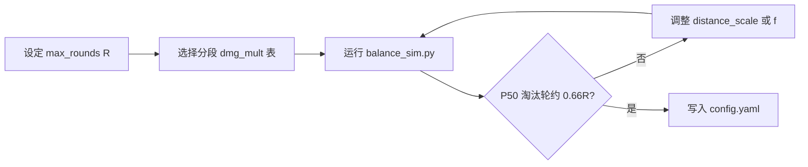

# 游戏数值设计

> **上级文档：** [neo-design.md](neo-design.md) §4.2、[design-game-rules.md](design-game-rules.md) §5–6  
> **校准工具：** [`scripts/balance_sim.py`](../scripts/balance_sim.py)

本文定义 HP、分段 `dmg_mult`、距离缩放、以及 `ffa_hp` / `ranking` 两套伤害模式的推荐默认值与调参方法。

---

## 1. 符号

| 符号 | 含义 |
|------|------|
| `d` | 归一化欧氏距离，`∈ [0, √2]` |
| `s` | 缩放距离，`s = d × distance_scale` |
| `m_r` | 第 `r` 轮（0-based）伤害倍率 |
| `R` | `max_rounds` |
| `H` | `max_hp` |
| `N` | 当局玩家数 |
| `ε` | `rank_tolerance`（排名并列阈值，与 `s` 同量纲） |

**伤害通式：**

```text
ffa_hp:   damage_i = s_i × m_r
ranking:  damage_i = base(rank_i) × m_r
          base(rank) = (H / (f × R)) × (rank - 1) / max(N - 1, 1)
```

其中 `f = scoring.ranking.hp_budget_factor`（仅 ranking 模式）。

---

## 2. 设计目标

| 目标 | 说明 |
|------|------|
| 分段倍率 | 保持 `dmg_mult_schedule` 分段结构；**末段不超过 2×–3×**，避免 ref 的 4× 极端爆发 |
| 淘汰节奏 | 约 **50% 玩家在 66% 回合**（R=16 时第 11 轮）出局或处于淘汰边缘 |
| 高手存活 | 距离分布上端（约 P90+）的玩家应能撑到后段；Top 玩家可打满 R 轮 |
| 排名 tolerance | **禁止 relay**：并列只与当前簇内最优（最小）距离比较，不沿排序链传递 |

---

## 3. 分段 `dmg_mult`（推荐默认）

### 3.1 主方案（末段 2×）

```yaml
dmg_mult_schedule:
  - { rounds: 11, mult: 1.0 }   # 第 1–11 轮
  - { rounds: 3, mult: 1.5 }    # 第 12–14 轮
  - { rounds: 999, mult: 2.0 }  # 第 15 轮起
```

| 轮次 | 倍率 | 累计倍率和 |
|------|------|------------|
| 1–11 | 1.0 | 11.0 |
| 12–14 | 1.5 | +4.5 → 15.5 |
| 15–16 | 2.0 | +4.0 → **19.5** |

对比 ref（8×1 + 4×2 + 4×4 = **32**）：总压力约为 ref 的 61%，后期峰值倍率减半。

### 3.2 备选方案（末段 3×）

若希望后段更刺激但仍低于 ref 4×：

```yaml
dmg_mult_schedule:
  - { rounds: 11, mult: 1.0 }
  - { rounds: 3, mult: 2.0 }
  - { rounds: 999, mult: 3.0 }
```

累计倍率和 = 23.0，模拟中 P50 淘汰约第 9 轮，偏快；仅建议在私房明确加速局时使用。

---

## 4. `distance_scale` 与 `max_hp`

### 4.1 固定 `max_hp = 100`

与 ref 一致，便于玩家与 UI 迁移。

### 4.2 推荐 `distance_scale = 68`

用 [`scripts/balance_sim.py`](../scripts/balance_sim.py) 在技能分布 `LogNormal(μ=-2.1, σ=0.55)` 下校准（μ 对应「中等偏上」休闲玩家）：

| 指标 | ffa_hp（scale=68） |
|------|---------------------|
| 单人 P50 死亡轮 | **第 11 轮**（≈ 69% 局程） |
| 4 人局第 11 轮阵亡比例中位数 | **50%** |
| 单人 P90 死亡轮 | 第 13 轮 |
| μ=-2.5（高手）16 轮存活率 | ~7% |

**调参旋钮：**

- 淘汰太早 → **降低** `distance_scale` 或延长 `mult: 1.0` 段
- 淘汰太晚 → **提高** `distance_scale` 或略增末段倍率（不超过 3×）
- 不建议同时大改 `H` 与 `distance_scale`，优先动 `distance_scale`

### 4.3 灾难单轮校验

乱猜 / 超时（中心点）典型 `d ≈ 0.35–0.5`：

```text
s_bad ≈ 0.45 × 68 ≈ 30.6
末轮伤害 ≈ 30.6 × 2.0 ≈ 61   （约占 H 的 61%，致命但不至秒杀满血）
```

ref 末轮 4× 下同距离约 122，容易一击定胜负；Neo 默认方案更温和。

---

## 5. `ffa_hp` 模式

### 5.1 规则

每人只对自己距离负责，与 N 无关：

```text
damage_i = s_i × m_r
```

实现：[`neo/damage/registry.py`](../neo/damage/registry.py) `ffa_hp`。

### 5.2 推荐 config 片段

```yaml
scoring:
  mode: ffa_hp
  damage_fn: ffa_hp
  distance_scale: 68
```

### 5.3 与 2 人 ref 的关系

公式结构相同，但倍率表与 `distance_scale` 已下调，**非 bit-for-bit**。2 人局只是 `N=2` 的 FFA 特例。

---

## 6. `ranking` 模式

### 6.1 距离排名（含 tolerance，无 relay）

按 `s` **升序**排序后扫描：

1. 第一名自成簇，记录 `cluster_min = s`
2. 对下一名：若 `s - cluster_min ≤ ε` → **同 rank**，加入当前簇（`cluster_min` 不变）
3. 否则 → 开新簇，rank = `index + 1`（竞赛排名 1,1,3…）

**反例（ε=0.1，原始距离）：**

| 玩家 | s | 判定 |
|------|---|------|
| A | 0.1 | rank 1，cluster_min=0.1 |
| B | 0.2 | 0.2−0.1=0.1 ≤ ε → rank 1 |
| C | 0.3 | 0.3−**0.1**=0.2 > ε → rank **3**（不因 B−C 链式并列） |

实现：[`neo/scoring/rank.py`](../neo/scoring/rank.py) `rank_by_distance`。

**推荐 `rank_tolerance = 3.0`（缩放距离）** ≈ `d = 0.044`，避免鼠标手抖造成名次跳变。

### 6.2 伤害映射

```text
weight(rank) = (rank - 1) / max(N - 1, 1)
base(rank)   = (H / (f × R)) × weight(rank)
damage_i     = base(rank_i) × m_r
```

- rank 1（最近）：**0 伤害**
- rank N（最远）：`base = H / (f × R)` 为每轮「满额」基础扣血

### 6.3 推荐 `hp_budget_factor = 0.22`

在 N=4、scale=68、主倍率表下，第 11 轮 **50% 玩家阵亡**（中位数）。  
N=2 时末位每轮扣 `H/(f×R)×m_r`，节奏更快；N=8 更慢——可通过私房覆盖 `f`。

```yaml
scoring:
  mode: ranking
  damage_fn: ranking
  distance_scale: 68
  rank_tolerance: 3.0
  ranking:
    hp_budget_factor: 0.22
```

### 6.4 N 人示例（R 第 1 轮，m=1，H=100，f=0.22，N=4）

| rank | weight | base | 说明 |
|------|--------|------|------|
| 1 | 0 | 0 | 最近 |
| 2 | 1/3 | 7.6 | |
| 3 | 2/3 | 15.2 | |
| 4 | 1 | 22.7 | 最远 |

---

## 7. 终局排名（与回合排名区分）

| 场景 | 规则 | 配置 |
|------|------|------|
| 回合内 distance 并列 | `rank_by_distance` + `rank_tolerance` | `rank_tolerance` |
| 终局 HP 并列 | `rounds_survived` ↓，`hp` ↓，竞赛排名 | `tie_threshold`（默认 0.1） |

直播排行榜与终局均使用 `rounds_survived` + `hp`（[`assign_standings_ranks`](../neo/scoring/rank.py)）。

---

## 8. 校准流程



```bash
python scripts/balance_sim.py
```

修改脚本内 `schedule`、`distance_scale`、`hp_budget_factor` 后重跑，直至输出满足目标。

---

## 9. 验收标准

- [ ] `rank_by_distance`：0.1/0.2/0.3、ε=0.1 → ranks 1,1,3
- [ ] 无 relay：0.1/0.15/0.19 同簇，0.35 为 rank 4
- [ ] ffa_hp：4 人局第 11 轮阵亡比例中位数 ≈ 50%（模拟）
- [ ] ranking：同上（f=0.22，N=4）
- [ ] `dmg_mult` 末段 ≤ 3×（默认配置 ≤ 2×）

---

## 10. 附录：ref 对照

| 项目 | ref | Neo 默认 |
|------|-----|----------|
| max_hp | 100 | 100 |
| distance_scale | 100 | 68 |
| 倍率表 | 8/4/rest × 1/2/**4** | 11/3/rest × 1/1.5/**2** |
| 累计倍率和（16 轮） | 32 | 19.5 |
| 伤害目标 | 2 队互比 | FFA 自身 / ranking 簇内 |

---

---

## 11. 积分模式（`scoring.mode: points`）

与 HP 模式独立；全员打满 `max_rounds`，终局按 `player_score` 排名。

### 11.1 points + `ffa`

```text
points_i = max(score_cap - s_i, 0) × dmg_mult
```

推荐 `score_cap: 50`（与 `distance_scale: 68` 配合：猜中 ≈ 50 分/轮 × mult）。

### 11.2 points + `ranking`

```text
points_i = (N - rank_i + 1) × dmg_mult
```

| N=4, mult=1 | rank | 得分 |
|-------------|------|------|
| 最近 | 1 | 4 |
| | 2 | 3 |
| | 3 | 2 |
| 最远 | 4 | 1 |

并列使用 `rank_by_distance` + `rank_tolerance`（无 relay）；同名次同分。

### 11.3 与 hp + ranking 的区别

| | hp + ranking | points + ranking |
|--|--------------|------------------|
| 结算 | 扣血 | 加分 |
| 公式 | 按 rank 比例扣 `hp_budget` | 按 rank 逆序整数分 |
| 提前出局 | 可以 | 不可以 |
| N 缩放 | `2/N` 归一化总扣血 | 不需要（分数随 N 自然扩展） |

---

*HP 模式数值见上文 §5–6；实现见 `neo/settlement/`。*
