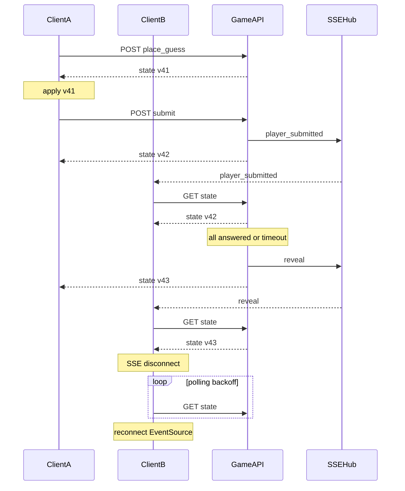

# 游戏内网络与互动 — 设计规格

> **上级文档：** [neo-design.md](neo-design.md) §6  
> **关联文档：** [design-game-rules.md](design-game-rules.md)（阶段与字段）、[design-game-ui.md](design-game-ui.md)（SyncScheduler 消费方）、[design-lobby.md](design-lobby.md)（大厅→局内衔接）  
> **参考实现：** [`ref/static/index.html`](../ref/static/index.html)、[`ref/app.py`](../ref/app.py)

---

## 1. 设计哲学

- **Trigger-and-refresh**：SSE 仅通知「该拉取状态」；**`GET /api/state` 为唯一真相**
- **`state_version`**：单调递增，防止乱序响应覆盖新 UI
- **删除** ref 未实现的 `ack_refresh`、`data.refresh`、硬刷新路径
- 大厅 SSE 与局内 SSE **分离**（局内本文档范围）

---

## 2. `state_version`

| 项目 | 规则 |
|------|------|
| 作用域 | 房间级 |
| 初值 | `0`；`init_room` 后首次暴露为 `1` |
| 递增 | 任何成功改变 `RoomState` 的 API（含超时推进、AFK 自动 submit） |
| 携带 | 所有 `GET /api/state` 与 mutating POST 的 JSON 响应 |
| 客户端 | 若 `incoming.state_version < local.state_version` → **丢弃**；≥ → `updateUI` 并更新 local |

不引入 `phase_id` / ETag（保持简单）。

---

## 3. SyncScheduler

封装客户端同步逻辑，供 [design-game-ui.md](design-game-ui.md) 使用。

### 3.1 API

```javascript
// sync.js 对外接口
SyncScheduler.connect(roomId, playerId, { observe: boolean })
SyncScheduler.postAction(path, body?) -> Promise<State>
SyncScheduler.fetchState() -> Promise<State>
SyncScheduler.onState(callback)   // 每次有效 state 更新
SyncScheduler.onLog(callback)       // debug 日志行
SyncScheduler.destroy()
```

### 3.2 行为

```
connect:
  1. localVersion = 0
  2. fetchState()
  3. evtSource = new EventSource(`/events/${roomId}`)
  4. evtSource.onmessage = () => scheduleFetch()  // 不解析 event 类型也可统一拉取
  5. evtSource.onerror = () => startPollingFallback()

postAction(path, body):
  1. POST with room + player_id query
  2. applyStateIfNewer(response)
  3. scheduleFetch(debounce 100ms)  // 单航班：多次 schedule 合并为一次

scheduleFetch:
  - 若已有待执行 fetch → 取消前一个定时器
  - 100ms 后执行 fetchState()

fetchState:
  GET /api/state?room=&player_id=
  applyStateIfNewer(data)

applyStateIfNewer(data):
  if data.state_version >= localVersion:
    localVersion = data.state_version
    onState(data)

pollingFallback (on SSE error):
  - 关闭 EventSource
  - 每 2^attempt 秒 GET /api/state（attempt 上限 4，最大 16s）
  - 连续成功 2 次后尝试重建 EventSource
```

### 3.3 与 ref 差异

| ref | Neo |
|-----|-----|
| 无 version | 丢弃旧包 |
| 每次 postAction 必 fetch | 单航班 debounce |
| SSE onerror 空 | 指数退避轮询 + 重连 |
| submit → 收 `reveal` | 收 `player_submitted` / `reveal` 均 → fetch |

---

## 4. 局内 SSE

### 4.1 端点

```
GET /events/{room_id}
```

与 ref 相同路径；payload 为**纯文本事件名**（无 JSON body），客户端统一 `fetchState`。

### 4.2 事件表

| 事件 | 广播时机 | 说明 |
|------|----------|------|
| `player_submitted` | 任一玩家 `submit` 成功 | **替代** ref 单方 submit 就 `reveal` |
| `reveal` | 进入 reveal 阶段（guess 全员提交或超时后） | |
| `next_round` | 进入新 guess 回合 | |
| `player_status` | `player_connected` 变化 | |
| `game_over` | `phase` → `game_over` | |

**废弃：** `opponent_left` 作为终局信号；断线不结束游戏。

### 4.3 广播实现

沿用 ref 模式：每房间 `List[Queue]`，`broadcast(room_id, event_name)`。

---

## 5. REST API

### 5.1 查询参数约定

- 所有局内 API：`?room={room_id}&player_id={player_id}`
- 观战者（`observe=1`）：仅允许 `GET /api/state`；mutating 返回 `403 SPECTATOR_READONLY`

### 5.2 端点一览

| Method | Path | Body | 说明 |
|--------|------|------|------|
| GET | `/api/state` | — | 主读模型 |
| POST | `/api/place_guess` | `{ lat, lon }` | |
| POST | `/api/submit` | — | 需已有 coord |
| POST | `/api/agree_next` | — | |
| POST | `/api/exit` | — | 断开当前 connection |
| GET | `/api/reveal` | — | debug only |
| POST | `/api/prev_round` | — | debug only |
| POST | `/api/next_round` | — | debug only |

**废弃：** `/api/ack_refresh`、`/api/init`（由大厅 `init_room` 替代）

### 5.3 `/api/exit` 语义

1. 从该 `player_id` 的 connection 集合移除当前 connection（由 session / body 带 `connection_id`）
2. 若集合为空 → `player_connected[id] = false`；广播 `player_status`
3. **不**删除玩家席位；不终局
4. 客户端 `pagehide`：`sendBeacon` 调用（同 ref）

---

## 6. `/api/state` 响应

### 6.1 完整字段

```json
{
  "state_version": 42,
  "phase": "guess",
  "phase_remaining_seconds": 25,
  "round": 3,
  "total_rounds": 16,
  "dmg_mult": 2.0,
  "self_player_id": "alice",
  "player_count": 4,
  "submitted_count": 2,
  "observe_mode": false,
  "players": [
    {
      "player_id": "alice",
      "slot": 0,
      "hp": 80.0,
      "answered": true,
      "ready_next": false,
      "connected": true,
      "rank": 1,
      "round_damage": null
    }
  ],
  "coords": {
    "alice": [0.32, 0.41]
  },
  "answer_revealed": false,
  "answer_coord": null,
  "answer_loc": null,
  "question_img": "dataset/foo.png",
  "question_comment": "…",
  "rankings": null,
  "has_next": true,
  "has_prev": false,
  "debug": false,
  "debug_log": []
}
```

### 6.2 坐标可见性过滤（服务端）

| 条件 | `coords` | `answer_coord` | `answer_loc` |
|------|----------|----------------|--------------|
| `phase=guess` 且未 reveal | 仅 `self_player_id` | 隐藏 | 隐藏 |
| `phase=reveal` 或之后 | 全员 | 显示 | 显示 |

`submitted_count` = `count(player_answered==true)`，Guess 阶段全员可见。

### 6.3 `round_damage`

- Guess：`null`
- Reveal / agree_next：填入 `players[].round_damage`

### 6.4 终局

`phase=game_over`：`rankings` 填充；`answer_revealed=true`。

---

## 7. 幂等与安全

| 操作 | 幂等键 | 行为 |
|------|--------|------|
| 伤害结算 | `last_damage_applied_round == round_index` | 跳过重复扣血 |
| Guess 超时 | `last_timeout_applied == (round_index, guess)` | 只执行一次 |
| Agree 超时 | `last_timeout_applied == (round_index, agree_next)` | 只执行一次 |
| submit | `player_answered[id]` | 已 true → 200 no-op |
| place_guess | 已 answered | no-op |

并发：房间级 `threading.Lock`（同 ref `@room_lock_guard`）。

---

## 8. 序列图



---

## 9. 与大厅衔接

| 步骤 | 负责模块 |
|------|----------|
| 大厅 `match_starting` | 跳转 `index.html?room&player_id` |
| 首屏 | `SyncScheduler.connect`；**不**调用 lobby API |
| `room` 不存在 | 404 → 提示回大厅 |
| 重连 IN_GAME | 同 URL；`exit` 后再连恢复 `connected` |

`connection_id`：局内与大厅共用同一 tab 级 UUID（`localStorage` 或 session 生成），供 `exit` / heartbeat 使用。

---

## 10. 可靠性检查表

| 机制 | Neo 决定 |
|------|----------|
| SSE 断线 | 指数退避轮询 + 重连 EventSource |
| 写后一致性 | POST 响应 + 单航班 debounce fetch |
| `ack_refresh` | **删除** |
| submit 广播 | `player_submitted`；`reveal` 仅阶段切换 |
| 页面关闭 | `sendBeacon` `/api/exit` |
| 乱序 | `state_version` 丢弃旧包 |
| visibilitychange | v1 **不**暂停服务端计时 |

---

## 11. 错误响应

```json
{ "error": "Human message", "code": "ALREADY_ANSWERED" }
```

| code | HTTP | 场景 |
|------|------|------|
| `MISSING_ROOM` | 400 | |
| `MISSING_PLAYER_ID` | 400 | |
| `ROOM_NOT_FOUND` | 404 | |
| `NOT_IN_ROOM` | 403 | player_id 不在本房 |
| `SPECTATOR_READONLY` | 403 | 观战 mutate |
| `ALREADY_ANSWERED` | 409 | 重复 submit |
| `NO_GUESS` | 400 | 无 coord 提交 |
| `WRONG_PHASE` | 409 | 阶段不允许 |

---

## 附录：ref API 迁移

| ref | Neo |
|-----|-----|
| `?team=blue` | `?player_id=alice` |
| `team_hp` | `players[].hp` |
| `coords.blue/red` | `coords[player_id]` |
| `winner` | `rankings` |
| `opponent_left` SSE | `player_status`（不终局） |

---

*参见 [design-game-rules.md](design-game-rules.md)、[design-game-ui.md](design-game-ui.md)*
