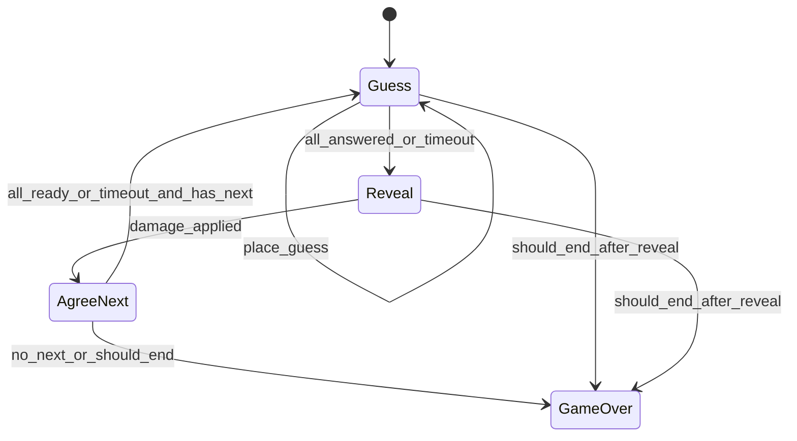

# 游戏内规则 — 设计规格

> **上级文档：** [neo-design.md](neo-design.md) §4  
> **关联文档：** [design-lobby.md](design-lobby.md)（`init_room`）、[design-game-ui.md](design-game-ui.md)（展示）、[design-game-network.md](design-game-network.md)（API/SSE）  
> **参考实现：** [`ref/defs.py`](../ref/defs.py)、[`ref/database.py`](../ref/database.py)、[`ref/calc.py`](../ref/calc.py)、[`ref/app.py`](../ref/app.py)

---

## 1. 概述

### 1.1 对战形态

- **FFA 混战**，无组队
- 计分由服务端 **config 全局指定**，玩家不可选
- **两大模式**（`scoring.mode`）：
  - `hp`：扣血生存；子插件 `damage_fn` = `ffa` \| `ranking`
  - `points`：累计积分，全员打满 `max_rounds`；子插件 `scoring_fn` = `ffa` \| `ranking`
- `dmg_mult_schedule` 两种模式均作为每轮倍率使用

| 模式 | 子插件 | 每轮结算 | 提前终局 |
|------|--------|----------|----------|
| `hp` + `ffa` | 对自身距离扣血 | `s × dmg_mult` | HP≤0 等 |
| `hp` + `ranking` | 按距离排名扣血 | 见 §5.3 | 同左 |
| `points` + `ffa` | 距离换分 | `max(cap - s, 0) × dmg_mult` | 仅轮次耗尽 |
| `points` + `ranking` | 逆序名次给分 | `(N - rank + 1) × dmg_mult` | 仅轮次耗尽 |

数值详见 **[design-game-balance.md](design-game-balance.md)**。

### 1.2 玩家集合

| 集合 | 参与阶段/伤害 | 说明 |
|------|---------------|------|
| `players[]` | 是 | 大厅 Join 成功并 `init_room` 时写入 |
| `spectators[]` | 否 | 仅只读 state |
| AFK 玩家 | 是（自动操作） | 仍在 `players[]`，`connected=false` |

### 1.3 坐标系

沿用 ref：归一化 `[0,1]²`，`lat` = y（0 顶 → 1 底），`lon` = x；对应 `map.jpg`。

---

## 2. 房间状态（`RoomState`）

### 2.1 字段

| 字段 | 类型 | 说明 |
|------|------|------|
| `room_id` | str | |
| `room_config` | object | 来自大厅 + 全局 config 合并快照 |
| `players` | `List[PlayerState]` | 见下 |
| `round_index` | int | 0-based 内部；API 展示 `round = round_index + 1` |
| `phase` | enum | `guess` \| `reveal` \| `agree_next` \| `game_over` |
| `phase_started_at` | float | 服务端时间戳 |
| `que_history` | `List[int]` | 已采样题目 global id |
| `player_hp` | `Dict[player_id, float]` | |
| `player_coord` | `Dict[player_id, Coord]` | 当前回合猜测 |
| `player_answered` | `Dict[player_id, bool]` | 本回合是否已 submit |
| `player_ready_next` | `Dict[player_id, bool]` | agree 阶段 |
| `player_round_damage` | `Dict[player_id, float]` | 本回合伤害（hp 模式，Reveal 后） |
| `player_score` | `Dict[player_id, float]` | 累计积分（points 模式） |
| `player_round_score` | `Dict[player_id, float]` | 本回合得分（points 模式） |
| `player_slot` | `Dict[player_id, int]` | join 顺序，用于 pin 颜色 |
| `player_connected` | `Dict[player_id, bool]` | |
| `rounds_survived` | `Dict[player_id, int]` | HP 曾 > 0 的完整回合数（终局排名用） |
| `last_damage_applied_round` | int | 幂等：已结算伤害的 round_index |
| `last_timeout_applied` | `(round_index, phase)` | 幂等：阶段超时 |
| `state_version` | int | 每次 mutating 操作 +1 |
| `rankings` | `List[RankingEntry]` | 终局填充 |

**`PlayerState`（API 摘要）：**

```json
{
  "player_id": "alice",
  "slot": 0,
  "hp": 80.0,
  "answered": false,
  "ready_next": false,
  "connected": true,
  "round_damage": null,
  "rank": 1
}
```

### 2.2 `init_room`

由大厅 `STARTING` 调用（[design-lobby.md](design-lobby.md) §10）：

```text
init_room(room_id, player_ids ordered by joined_at, room_config):
  - 创建 RoomState
  - player_hp[id] = config.rounds.max_hp
  - player_score[id] = 0
  - player_slot[id] = 0..N-1
  - player_connected[id] = true
  - rounds_survived[id] = 0
  - round_index = 0
  - phase = guess
  - sample_question() → 开始第一题
  - phase_started_at = now()
```

---

## 3. 阶段状态机

### 3.1 状态图



### 3.2 阶段推进总览

| 阶段 | 进入条件 | 推进条件 | 下一阶段 |
|------|----------|----------|----------|
| `guess` | 回合开始 / agree 完成 | `all(player_answered)` 或超时 | `reveal` |
| `reveal` | guess 推进 | 伤害结算完成（同步） | `agree_next` 或 `game_over` |
| `agree_next` | reveal 完成且未终局 | `all(player_ready_next)` 或超时 | `guess` 或 `game_over` |
| `game_over` | 终局条件满足 | — | — |

---

## 4. 各阶段详细规则

### 4.1 Guess 阶段

**超时：** `config.timeouts.place_guess`（默认 30s）

**玩家操作：**

- `place_guess(lat, lon)`：写入 `player_coord`；若已 `answered` 则 no-op
- `submit`：要求已有 coord；设 `player_answered[id]=true`

**推进：**

- 当 `∀p: player_answered[p]` → 调用 `_enter_reveal()`
- 超时（定时任务或请求时检查 `phase_started_at`）→ `_apply_guess_timeout()` → `_enter_reveal()`

**超时处理 `_apply_guess_timeout`：**

| 玩家状态 | 行为 |
|----------|------|
| 未标点 | `coord = (0.5, 0.5)`，`answered = true` |
| 已标点未 submit | `answered = true` |
| 已 submit | 无操作 |

**AFK（`connected=false`）：**

- 回合进入 `guess` 时**立即**对该玩家执行：中心点 + `answered=true`（不等待、不阻塞他人）

**客户端可见性（与 API 过滤一致）：**

- 仅自己的 `coord`
- `submitted_count` / `player_count`（见 [design-game-network.md](design-game-network.md)）

**SSE：** 任一玩家 submit 后广播 `player_submitted`（非 `reveal`）

### 4.2 Reveal 阶段

**触发：** `_enter_reveal()` 在 guess 推进时调用一次（幂等）

**步骤：**

1. 设 `phase = reveal`（若尚未）
2. 取当前题目真实坐标 `answer_coord`
3. 对每个玩家计算展示距离（与 ref 一致）：
   ```text
   distance = euclidean(player_coord, answer_coord) * distance_scale
   ```
4. 组装 `SettlementContext`（同原 `DamageContext`）
5. **hp 模式**：`damage_fn` → 扣 `player_hp`，写 `player_round_damage`，更新 `rounds_survived`
6. **points 模式**：`scoring_fn` → 累加 `player_score`，写 `player_round_score`；**不**改 HP
7. `last_damage_applied_round = round_index`（幂等，两种模式共用）
8. 评估 `_should_end_game()`（points 模式恒 false，仅轮次耗尽终局）
9. 广播 SSE `reveal`

**展示：** 全员 `coords`、答案坐标；hp 模式显示 `round_damage`，points 模式显示 `round_score`

### 4.3 AgreeNext 阶段

**超时：** `config.timeouts.agree_next`（默认 10s）

**玩家操作：** `agree_next` → `player_ready_next[id] = true`

**推进：**

- `all(player_ready_next)` 或超时 → `_advance_round()`
- 超时 / AFK：未 ready 的玩家自动 `ready_next = true`

**`_advance_round()`：**

1. 若 `round_index + 1 >= max_rounds` → `game_over`
2. 否则 `round_index++`；`reset_round_fields()`；`sample_question()`；`phase = guess`；`phase_started_at = now()`
3. 对 `connected=false` 玩家立即执行 AFK 猜题
4. 广播 SSE `next_round`

### 4.4 GameOver

- 计算 `rankings`（§6）
- 广播 SSE `game_over`
- 不再接受游戏内 mutating API（除 debug）

---

## 5. 结算插件架构

实现：`neo/settlement/`（`damage/` = hp 模式，`points/` = 积分模式）。

### 5.1 接口

```python
SettlementContext = TypedDict({
    "distances": Dict[str, float],
    "round_index": int,
    "dmg_mult": float,
    "config": dict,
    "player_ids": List[str],
})
```

- **hp 模式**：`config.scoring.damage_fn` → `ffa` \| `ranking`（`ffa_hp` 为别名）
- **points 模式**：`config.scoring.scoring_fn` → `ffa` \| `ranking`

### 5.2 hp + `ffa`

```text
damage[player_id] = distances[player_id] * dmg_mult
```

### 5.3 hp + `ranking`

```text
rank_i = rank_by_distance(distances, rank_tolerance)
damage_i = (H / (f × R)) × (2/N) × (rank_i - 1) / (N - 1) × dmg_mult
```

`ranking.player_scale: true` 时启用 `2/N` 房间总扣血归一化。

### 5.4 points + `ffa`

```text
points_i = max(score_cap - s_i, 0) * dmg_mult
```

### 5.5 points + `ranking`

```text
points_i = (N - rank_i + 1) * dmg_mult
```

并列同名次同分；`rank_by_distance` 无 relay（见 [design-game-balance.md](design-game-balance.md)）。

### 5.6 模块化目标

- 调整游戏性时仅更换 `damage_fn` / `scoring_fn` 或 config，不改阶段机
- debug 面板记录每轮结算输入/输出

---

## 6. 胜负与排名

### 6.1 终局触发 `_should_end_game()`

**points 模式：** 恒 `false`（不因 HP）；仅 `max_rounds` 耗尽终局。

**hp 模式：** 满足任一即终局：

1. `round_index + 1 >= max_rounds` 且在 agree 推进后
2. Reveal 后：`scoring.end_on_hp_zero`（默认 `true`）且存在玩家 `hp <= 0`
3. 仅剩 1 名玩家 `hp > 0`

**不因单人断线终局。**

### 6.2 最终排名算法

**hp 模式：**

1. 主键 `rounds_survived` 降序，次键 `hp` 降序
2. 平局：`|hp_a - hp_b| < tie_threshold`

**points 模式：**

1. 主键 `player_score`（总分）降序
2. 平局：`|score_a - score_b| < tie_threshold`
3. 输出 `rankings`：

```json
[
  { "player_id": "alice", "rank": 1, "hp": 12.5, "rounds_survived": 16 },
  { "player_id": "bob", "rank": 2, "hp": -3.0, "rounds_survived": 14 }
]
```

### 6.3 与 ref 差异（N=2）

| 项目 | ref | Neo |
|------|-----|-----|
| 胜负 | 单一 `winner` / draw | `rankings` 列表 |
| HP≤0 | 立即判胜 | 可继续（若未启用立即终局）；排名考虑负 HP |
| 平局 | HP 差 < 0.1 | 同阈值，可多人同 rank |

2 人局在默认 config 下**近似** ref，但排名结构为列表，非 bit-for-bit。

---

## 7. AFK / 断线

| 项目 | 规则 |
|------|------|
| 重连 | 任意时间；同 `player_id` → `connected=true` |
| 断线标记 | 全部 connection `exit` 后 `connected=false` |
| Guess | 回合开始立即中心点 + submit |
| AgreeNext | 超时逻辑自动 ready |
| 结束游戏 | **不**因断线结束 |
| SSE | `player_status`（connected 变化） |

---

## 8. Config Schema

文件路径建议：`config.yaml`（或 `config.json`），启动时加载。

```yaml
players:
  min: 2
  max: 8

lobby:
  countdown_seconds: 10    # <0 表示达到 min 后不自动倒计时
  heartbeat_seconds: 5

rounds:
  max_rounds: 16
  max_hp: 100.0

timeouts:
  place_guess: 30
  agree_next: 10

scoring:
  mode: hp                  # hp | points
  damage_fn: ffa            # hp only
  scoring_fn: ffa           # points only
  distance_scale: 68
  score_cap: 50.0           # points + ffa
  rank_tolerance: 3.0
  tie_threshold: 0.1
  end_on_hp_zero: true      # hp only
  ranking:
    hp_budget_factor: 0.22
    player_scale: true

# 轮次伤害倍率 — 见 design-game-balance.md
dmg_mult_schedule:
  - { rounds: 11, mult: 1.0 }
  - { rounds: 3, mult: 1.5 }
  - { rounds: 999, mult: 2.0 }

# 玩家 pin 颜色（10 色，按 slot 索引取模）
pin_colors:
  - "#5557EE"
  - "#EE5755"
  - "#57EE55"
  - "#EEAA55"
  - "#AA55EE"
  - "#55EEAA"
  - "#EE55AA"
  - "#55AAEE"
  - "#EEEE55"
  - "#EE5555"
# 答案 pin：菱形 + #57EE55（绿色），不占用上表

debug:
  enabled: false           # 或 CLI --debug
```

大厅 `min/max` 可在建房时覆盖，但不得超过 config 全局上下限（可选校验）。

---

## 9. 题目采样

沿用 ref `database.sample_question()` 逻辑：

- `room_id` 派生 seed → `category_sampler` / `question_sampler` / `dmg_mult_selector`
- N 人局**不**按人头改变抽题
- 题库 schema 见 [neo-design.md](neo-design.md) §7

---

## 10. Debug 模式（规则侧）

当 `debug.enabled`：

- 允许 `prev_round` / `next_round` / `force_reveal` API（仅 debug）
- 日志写入结构化条目，供 UI 滚动窗展示
- 地图标点仍走正常 `place_guess`（UI 仅显示自己的 pin）

---

## 附录：阶段 × 服务端自动行为

| 阶段 | 定时检查 | AFK 玩家 |
|------|----------|----------|
| guess | 超时 → 自动 submit | 回合开始立即 submit |
| reveal | 无（瞬时） | — |
| agree_next | 超时 → 自动 ready | 同左 |
| game_over | — | — |

---

*参见 [design-game-ui.md](design-game-ui.md)、[design-game-network.md](design-game-network.md)*
