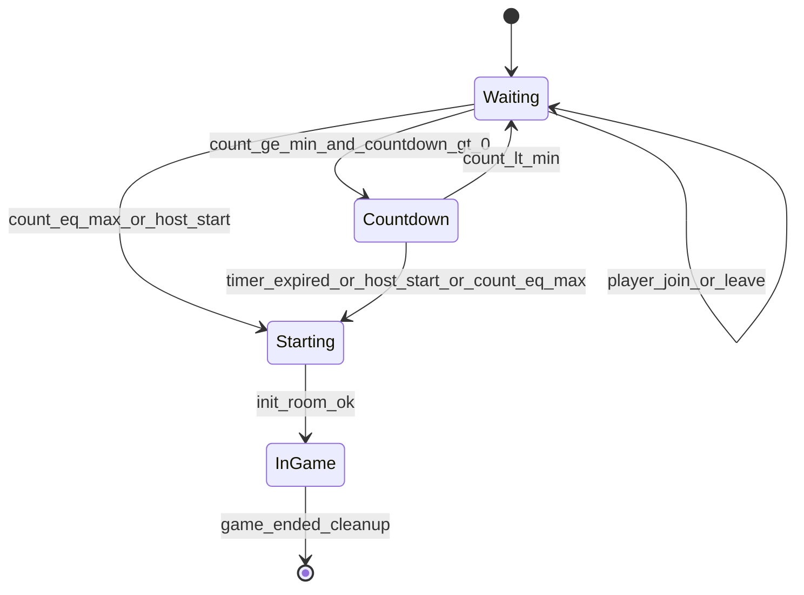

# 大厅匹配 — 设计规格

> **上级文档：** [neo-design.md](neo-design.md) §5  
> **关联文档：** [design-game-network.md](design-game-network.md)（局内衔接）、[design-game-rules.md](design-game-rules.md)（`init_room` 参数）  
> **参考实现：** [`ref/lobby.py`](../ref/lobby.py)、[`ref/static/lobby.html`](../ref/static/lobby.html)（**全部废弃**，逻辑完全重写）

---

## 1. 概述与边界

### 1.1 职责

| 纳入 | 排除 |
|------|------|
| 玩家/观战者进入等待室 | 题目采样、伤害计算 |
| 房间 min/max、倒计时、房主开房 | 局内阶段机 |
| 匹配成功 → 初始化游戏房间 → 跳转 | 题库坐标标定（属 debug 局内 UI） |

### 1.2 核心决策摘要（来自 neo-design）

- 玩家自选字符串 `player_id`；同 ID 多连接视为一人；**全部连接断开**才移出房间
- 大厅传输：**Lobby SSE** + REST；与局内 SSE **分离**
- 状态存储：**Redis**（v1 单进程可用 `InMemoryLobbyStore` 同接口）
- 快速匹配：服务端分配/合并 `WAITING` 房；首入者为房主；min/max 默认取自 config
- 私房：任意字符串 `room_id`；不可 mid-game join（同 ID 重连除外）
- 满 `max_players` 立即开始；≥ `min_players` 且倒计时 ≥ 0 时进入倒计时；房主可随时 `force_start`

### 1.3 与局内交接

匹配成功（`STARTING` → `IN_GAME`）后：

1. 服务端调用 `init_room(room_id, player_ids[], room_config)`（见 [design-game-rules.md](design-game-rules.md)）
2. 向房间内所有连接广播 SSE `match_starting`
3. 客户端跳转：`/index.html?room={room_id}&player_id={player_id}`（观战：`&observe=1`）
4. 局内模块通过 [design-game-network.md](design-game-network.md) 的 `GET /api/state` + `/events/{room_id}` 接管，**无需**再次调用 lobby join

---

## 2. 用户流程（UI）

### 2.1 页面结构

单页 `lobby.html`（或等价路由），背景与 ref 类似，内容区分为 **表单区** 与 **等待室区**。

```
+------------------------------------------+
|  Gensokyo Geo-Guesser | Lobby            |
+------------------------------------------+
|  Player ID *     [________________]      |
|  Room ID         [________________]      |
|    (留空 = 快速匹配)                      |
|  Min / Max       [2] / [8]  (仅房主可见)  |
|                                          |
|  [ Join ]  [ Observe ]  [ Cancel ]       |
+------------------------------------------+
|  --- 等待室（Join 后显示）---              |
|  Room: abc123   Host: alice              |
|  Players (3/8): alice*, bob, carol       |
|  Countdown: 7s ...  (或 Waiting...)      |
|  [ Start Game ]  (仅房主)                 |
+------------------------------------------+
|  状态条 / 错误提示                         |
+------------------------------------------+
```

`*` 表示房主；`Cancel` 在等待室外也可用于清空表单。

### 2.2 表单字段

| 字段 | 必填 | 说明 |
|------|------|------|
| `player_id` | 是 | 玩家自选字符串；非空、trim 后长度 1–32；允许字母数字与常见符号 |
| `room_id` | 否 | 留空 → 快速匹配；填写 → 加入/创建该私房 |
| `min_players` | 否 | 仅**房主**在等待室可修改；默认 `config.players.min` |
| `max_players` | 否 | 仅房主可修改；默认 `config.players.max`；须 `min ≤ max` |

`player_id` 持久化到 `localStorage`，下次进入预填。

### 2.3 按钮行为

| 按钮 | 可见条件 | 行为 |
|------|----------|------|
| **Join** | 未在等待室 | `POST /api/lobby/join`；成功后显示等待室、订阅 Lobby SSE |
| **Observe** | 未在等待室；`room_id` 必填 | `POST /api/lobby/observe`；进入观战等待；`IN_GAME` 后跳转 `observe=1` |
| **Cancel** | 等待室中或请求进行中 | `POST /api/lobby/leave`；关闭 SSE；恢复表单 |
| **Start Game** | 等待室中且当前用户为房主 | `POST /api/lobby/start` |

Join 点击后立即 `disabled`，防止双击（对齐 ref `lobby.html` 防双匹配）。

### 2.4 等待室 UI 元素

| 元素 | 数据源 |
|------|--------|
| 玩家列表 | `room_status.players[]`：每项 `{ player_id, is_host, connected }` |
| 人数 | `players.length` / `max_players` |
| 倒计时 | `countdown_remaining_seconds`；仅 `status=COUNTDOWN` 时显示 |
| 房主 Start | `self_player_id === host_id` |
| 观战者列表（可选折叠） | `spectators[]` |

状态文案示例：

| 状态 | 文案 |
|------|------|
| `WAITING` 且未达 min | `等待玩家加入… (需要至少 {min} 人)` |
| `WAITING` 且已达 min、无倒计时 | `已达最少人数，等待房主开始或更多玩家` |
| `COUNTDOWN` | `{n} 秒后开始` |
| `STARTING` | `正在进入游戏…` |
| `IN_GAME`（观战者） | `对局进行中，正在进入观战…` |

### 2.5 错误提示

使用页面内 **状态条**（非 `alert`），可手动关闭：

| 错误码 | 用户文案 |
|--------|----------|
| `ROOM_IN_GAME` | 房间已开始，无法加入（观战请用 Observe） |
| `ROOM_FULL` | 房间已满 |
| `INVALID_PLAYER_ID` | 玩家 ID 无效 |
| `NOT_HOST` | 仅房主可以开始游戏 |
| `CONNECTION_REPLACED` | 当前等待室已在另一个连接中打开 |

### 2.6 页面生命周期

- `pagehide`：关闭 SSE 和心跳，保留等待席位至 60 秒租约超时；主动 Cancel 才调用 leave。
- 定时 `POST /api/lobby/heartbeat`，当前间隔为 2 秒。恢复页面后立即校准。
- 连接被替换或租约超时后停止匹配、恢复 Join；不自动抢回席位。

---

## 3. 房间状态机（后端）

### 3.1 状态枚举

| 状态 | 含义 |
|------|------|
| `WAITING` | 接受玩家加入 |
| `COUNTDOWN` | 已达 min，倒计时中 |
| `STARTING` | 正在 `init_room`，即将广播跳转 |
| `IN_GAME` | 对局进行中；拒绝 lobby Join，已有局内页面通过游戏 API 重连 |

### 3.2 状态图



### 3.3 转移规则

| 事件 | 条件 | 动作 |
|------|------|------|
| 玩家加入 | `status=WAITING`，未满 max | 更新列表；评估是否触发倒计时或满员开房 |
| 玩家离开 | 全部 connection 断开 | 从 `players` 移除；若人数 < min 则 `COUNTDOWN→WAITING` |
| 达 min 且 `lobby.countdown_seconds ≥ 0` | `WAITING` | → `COUNTDOWN`；设置 `countdown_deadline` |
| 达 min 且 `lobby.countdown_seconds < 0` | `WAITING` | 保持等待，仅房主可开 |
| 人数 = max | 任意等待态 | → `STARTING`（跳过倒计时） |
| 倒计时到期 | `COUNTDOWN` | → `STARTING` |
| 房主 `force_start` | `WAITING` 或 `COUNTDOWN` | → `STARTING`（允许 < min） |
| `init_room` 完成 | `STARTING` | → `IN_GAME`；广播 `match_starting` |

### 3.4 快速匹配合并逻辑

`POST /api/lobby/join` 且 `room_id` 为空时：

1. 串行执行快速匹配的选择和加入；逐房间检查租约，先清除过期席位。
2. 优先返回同 `player_id` 已在等待的快速房间（`WAITING` / `COUNTDOWN`），用新连接替换旧连接。
3. 否则选择 min/max 相符且未满的等待房间；若无则创建 `room_{uuid}`，首入者为房主。
4. 已开始的房间不参与 Quick Join；玩家可以使用相同 ID 在其他房间继续匹配。

### 3.5 私房逻辑

- `room_id` 为客户端提供的任意字符串（建议 trim，空则走快速匹配）
- 首名 Join 的玩家为房主，可设置 min/max（写入房间状态）
- `WAITING` / `COUNTDOWN`：同 ID 的 Join 替换此前连接，保留席位、房主、配置和倒计时。
- 已在 `IN_GAME` 的房间：拒绝所有 lobby Join（包括相同 ID）；允许 Observe，已有局内页面独立重连。

---

## 4. 多连接语义

### 4.1 标识

| 标识 | 生成 | 作用 |
|------|------|------|
| `player_id` | 用户输入 | 席位主键 |
| `connection_id` | 客户端 UUID v4，tab 生命周期内不变 | 区分同一玩家的多个浏览器标签 |
| `room_id` | 快速匹配服务端生成或用户指定 | 房间主键 |

### 4.2 规则

1. `player_id` 只在房间内唯一；同 ID 可以同时加入多个不同房间，无全局占用锁。
2. 等待室中同 ID 的新 Join 替换旧 connection；旧 heartbeat 不得恢复旧连接，旧 leave 不得删除新连接。
3. 旧 SSE 收到 `connection_replaced` 后关闭；客户端恢复 Join 按钮，不自动重入。
4. 同 connection 重试 Join 保持幂等，不新增席位或重设已有配置。
5. `IN_GAME` 不接受 lobby Join；游戏页面通过游戏 API 恢复连接。原有有效的大厅 heartbeat 仍可恢复漏掉的开局通知。

### 4.3 Heartbeat 与陈旧清理

- 前台客户端每 2 秒上报心跳；等待租约为 `lobby.reconnect_grace_seconds`，当前为 60 秒。
- 服务端每秒 tick 检查过期；Join、heartbeat、配置更新和 Start 也先检查过期，再刷新租约或开局。
- 租约达到 60 秒即删除席位，保存新 revision，并广播更新；房主过期则转给剩余最早加入者。
- 人数不足 min 时取消倒计时，恢复 `WAITING`；先清理再检查倒计时，避免过期席位触发开局。
- 超时客户端收到 `membership_expired` / `present=false` 后停止匹配，用户可再次点击 Join。
- 活跃游戏的席位由游戏模块管理，不用等待室超时规则删除。

---

## 5. 观战者

| 项目 | 规则 |
|------|------|
| 入口 | 大厅 **Observe** 按钮（非 Join） |
| API | `POST /api/lobby/observe` |
| 席位 | 不计入 `players`；不计入 min/max；不触发倒计时 |
| 存储 | `spectators[]`：`{ player_id, connection_ids[] }` |
| `IN_GAME` 后 | 跳转 `index.html?room=&player_id=&observe=1`；只读局内 state |
| 重连 | 同 Join，使用 observe 流程 |

---

## 6. Redis 数据模型

### 6.1 Key 设计

| Key | 类型 | 内容 |
|-----|------|------|
| `lobby:room:{room_id}` | String (JSON) | 房间快照（见下） |
| `lobby:quick_pool` | Set | 可快速匹配合并的 `room_id` 列表 |
| `lobby:lock:{room_id}` | String | 分布式锁，TTL 5s（分片锁/actor 粒度） |

### 6.2 房间 JSON 结构

```json
{
  "room_id": "room_abc123",
  "status": "WAITING",
  "host_id": "alice",
  "min_players": 2,
  "max_players": 8,
  "countdown_deadline": null,
  "players": [
    {
      "player_id": "alice",
      "connection_ids": ["conn-uuid-1"],
      "connected": true,
      "joined_at": 1710000000.0
    }
  ],
  "spectators": [],
  "created_at": 1710000000.0
}
```

### 6.3 存储抽象

```text
interface LobbyStore {
  get_room(room_id) -> Room | null
  save_room(room) -> void
  delete_room(room_id) -> void
  acquire_matchmaking_lock() -> context manager
  quick_pool_add(room_id) / quick_pool_list() / quick_pool_remove(room_id)
}
```

- **生产/多实例：** Redis 实现
- **v1 本地开发：** `InMemoryLobbyStore` 实现相同接口；忽略服务端重启（neo-design §5.4 #5）

### 6.4 并发控制

- 每个 `room_id` 在 mutating 操作前获取 `lobby:lock:{room_id}`
- 快速匹配合并：对 `quick_pool` 扫描时逐 room 加锁，避免双写
- 单进程开发可用 `threading.Lock` per room 等价实现

---

## 7. Lobby SSE

### 7.1 端点

```
GET /events/lobby/{room_id}?player_id={player_id}&connection_id={connection_id}
```

- `Content-Type: text/event-stream`
- 连接建立时推送一条 `lobby_snapshot`（完整房间状态 JSON）

### 7.2 事件类型

| 事件 | payload | 触发时机 |
|------|---------|----------|
| `lobby_snapshot` | 房间完整 JSON | 连接建立 |
| `lobby_update` | `{ players, spectators, status, countdown_remaining_seconds }` | 人数/状态/倒计时变化 |
| `player_joined` | `{ player_id }` | 新玩家入房 |
| `player_left` | `{ player_id }` | 玩家全部 connection 离开 |
| `match_starting` | `{ room_id, player_ids[], game_url }` | `STARTING`→`IN_GAME` |
| `error` | `{ code, message }` | 房间解散等 |

### 7.3 客户端策略

1. Join 成功后 `new EventSource(sse_url)`
2. 收到事件 → 更新等待室 UI（以 `lobby_snapshot` / `lobby_update` 为准）
3. 收到 `match_starting` → `window.location.href = game_url`
4. `onerror` → 指数退避重连（1s, 2s, 4s… 上限 30s）+ 并行 `GET /api/lobby/room_status` 校准

---

## 8. REST API 规格

**废弃 ref 端点：** `/api/lobby/quick_match`、`/api/lobby/poll`、`/api/lobby/cancel_waiting` 及 `channel` 模型。

### 8.1 `POST /api/lobby/join`

**请求：**

```json
{
  "room_id": "optional-string-or-null",
  "player_id": "alice",
  "connection_id": "uuid",
  "min_players": 2,
  "max_players": 8
}
```

**响应 200：**

```json
{
  "room_id": "room_abc",
  "role": "player",
  "is_host": true,
  "sse_url": "/events/lobby/room_abc?player_id=alice",
  "room": { }
}
```

**错误：** `400` `INVALID_PLAYER_ID` | `409` `ROOM_FULL` | `409` `ROOM_IN_GAME`（非重连）

### 8.2 `POST /api/lobby/observe`

**请求：** `{ "room_id", "player_id", "connection_id" }`  
**响应：** 同 join，但 `role: "spectator"`，`is_host: false`

### 8.3 `POST /api/lobby/leave`

**请求：** `{ "room_id", "player_id", "connection_id" }`  
**响应：** `{ "ok": true }`  
移除 connection；可能触发 `player_left` 广播。

### 8.4 `POST /api/lobby/start`

**请求：** `{ "room_id", "player_id", "connection_id" }`（须为当前连接的 host）
**响应：** `{ "ok": true, "status": "STARTING" }`  
**错误：** `403` `NOT_HOST`

### 8.5 `GET /api/lobby/room_status`

**查询：** `?room_id=`  
**响应：** 房间 JSON 快照（SSE 断线校准用）

### 8.6 `POST /api/lobby/heartbeat`

**请求：** `{ "room_id", "player_id", "connection_id" }`  
**响应：** `{ "ok": true, "present": true, "room": {...} }`；被替换返回 `present=false, replaced=true`，已超时返回 `present=false`。心跳不能加入新 connection。

### 8.7 错误码枚举

| 代码 | HTTP | 说明 |
|------|------|------|
| `INVALID_PLAYER_ID` | 400 | ID 格式非法 |
| `ROOM_NOT_FOUND` | 404 | 房间不存在 |
| `ROOM_FULL` | 409 | 已达 max |
| `ROOM_IN_GAME` | 409 | 无法 join，可 observe |
| `NOT_HOST` | 403 | 非房主调用 start |
| `CONNECTION_REPLACED` | 409 | 旧连接不能修改或开始等待室 |

---

## 9. 鲁棒性场景

| # | 场景 | 服务端行为 | 客户端 UI |
|---|------|------------|-----------|
| 1 | 双击 Join | 幂等：同 player+connection 返回当前房间 | 按钮立即 disabled |
| 2 | 匹配成功前刷新 | 房间仍在；同 player_id 重连 | 提示可重新 Join 同一 room_id |
| 3 | A 取消，B 已在房 | A 席位释放；B 不受影响 | A 回表单；B 列表更新 |
| 4 | N=4 仅 3 人 | 等待或房主开房 | 显示 3/4 |
| 5 | 服务端重启 | **不处理**（v1 范围外） | — |
| 6 | 同 player_id 多开 | 共享席位，connected=true | 多 tab 均可收 SSE |
| 7 | SSE 收到 match_starting 但跳转失败 | 房间已 IN_GAME；可手动打开 game_url | 显示「进入游戏」链接 |
| 8 | 满员瞬间第三人 Join | 第三人收到 ROOM_FULL | 状态条提示 |
| 9 | sendBeacon leave 失败 | 心跳超时后清理 | 允许重连 |
| 10 | 并发 >10 人 | 分片锁 + Redis；参考扩展 `concur_test.py` | — |

---

## 10. 与局内模块衔接

### 10.1 `init_room` 调用

在 `STARTING` 状态、持锁执行：

```text
init_room(
  room_id: str,
  player_ids: List[str],      # 按 joined_at 排序；分配 slot 0..N-1
  room_config: {
    min_players, max_players,
    scoring: from global config,
    ...
  }
)
```

### 10.2 跳转 URL

| 角色 | URL |
|------|-----|
| 玩家 | `/index.html?room={room_id}&player_id={player_id}` |
| 观战 | `/index.html?room={room_id}&player_id={player_id}&observe=1` |

### 10.3 对局结束

局内 `game_over` 后由游戏模块将 lobby 房间标记删除或 `ENDED`；玩家点「回大厅」→ `lobby.html`（`player_id` 从 localStorage 预填）。

---

## 附录：与 ref 对照

| ref | Neo |
|-----|-----|
| FIFO 2 人配对 | N 人等待室 + 房主/满员/倒计时开房 |
| `channel` + 1s poll | Lobby SSE + heartbeat |
| `team` Blue/Red 分配 | `player_id` + join order slot |
| 15s 静默剔除 | heartbeat 超时 + SSE 通知 |
| 无观战 | Observe 按钮 |

---

*参见 [neo-design.md](neo-design.md)、[design-game-network.md](design-game-network.md)*
