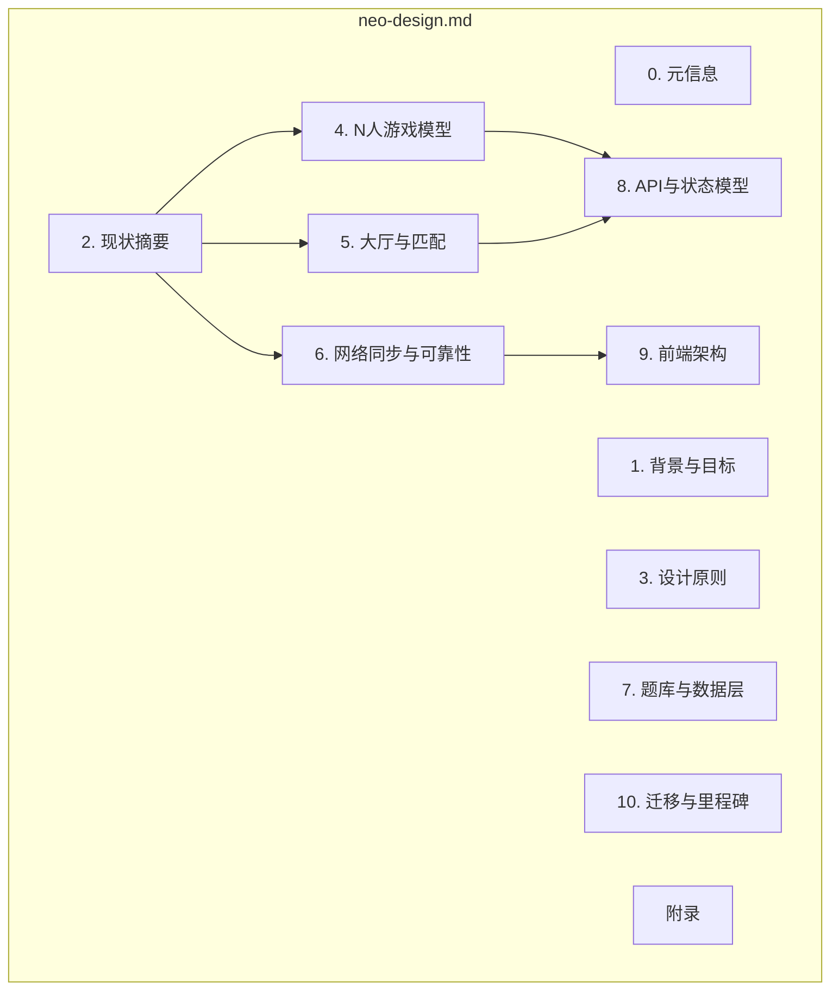
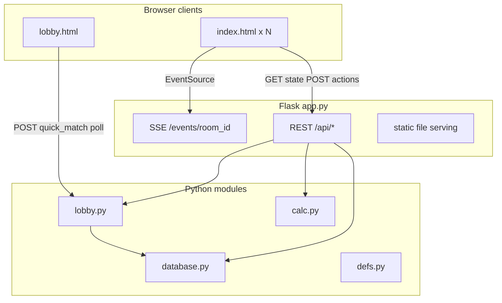
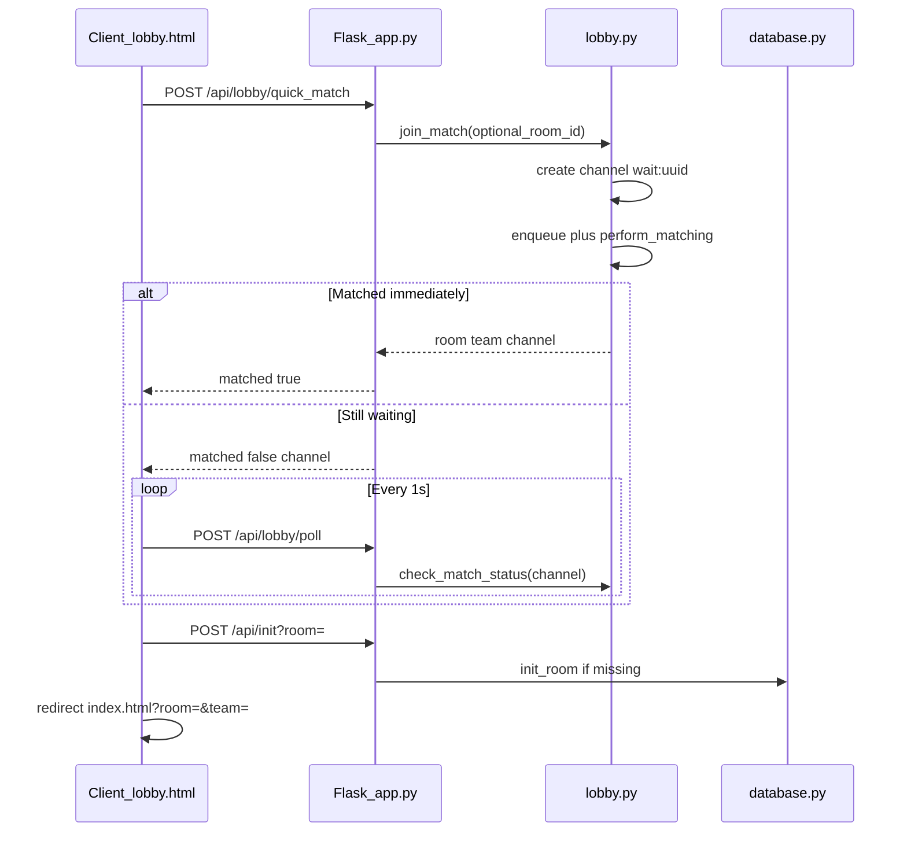
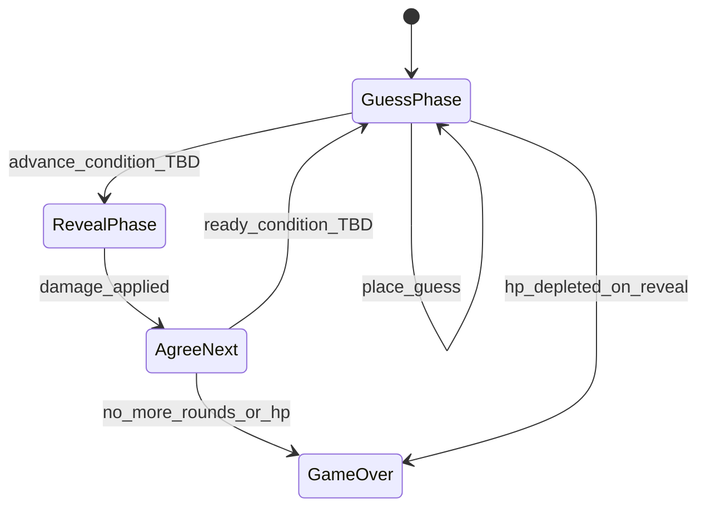
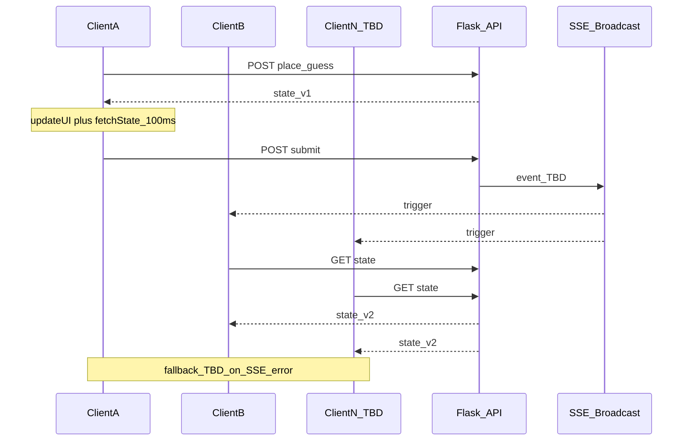

# Gensokyo Geo-Guesser Neo — 设计文档框架

> **文档性质：** 设计讨论骨架，非最终实现规格。  
> **参考索引：** [reference-codebase-index.md](reference-codebase-index.md)（下文简称 **索引**）  
> **参考实现：** [`ref/`](../ref/) 目录（原版 2 人对战，Neo 应用层尚未开始）

---

## 写作约定

- 需你决策处使用标记：`> **待决**` 或 `<!-- 待填写: ... -->`
- 每个决策小节结构：**背景（已填）→ 选项表（已填）→ 推荐（空白）→ 决定（空白）→ 理由（空白）**
- 全文中文；代码路径、API 路径、枚举值保持英文
- 本文档不替你做选择，仅基于参考实现列出有据可依的选项

---

## 0. 元信息

| 字段 | 值 |
|------|-----|
| 文档版本 | <!-- 待填写: 如 v0.1 --> |
| 作者 | <!-- 待填写 --> |
| 状态 | 草案 |
| 最后更新 | <!-- 待填写 --> |

### 0.1 范围声明

**纳入范围：**

1. N 人游戏模式（2 人作为 `N=2` 特例）
2. 大厅逻辑重设计（交互、匹配鲁棒性）
3. 网络同步与可靠性（基于参考版 trigger-and-refresh 模式）
4. API / 状态模型演进方向
5. 前端架构方向

**明确排除（非本文任务）：**

- 题库扩充工作流与策展工具（索引 §6、§9 Question pipeline 仅作边界引用）
- 具体 UI 视觉稿、像素级布局
- 部署 / WSGI 生产方案细节（索引 §9 仅作风险提示）
- 实现代码

### 0.2 与索引的对应关系

| 本文档章节 | 索引章节 | 主要参考文件 |
|------------|----------|--------------|
| §2 现状摘要 | §2–§7 | `ref/app.py`, `ref/lobby.py`, `ref/static/*.html` |
| §4 N 人游戏模型 | §3, §5 | `ref/defs.py`, `ref/database.py`, `ref/app.py` |
| §5 大厅与匹配 | §3, §4, §7 | `ref/lobby.py`, `ref/static/lobby.html` |
| §6 网络同步 | §2, §7, §9 | `ref/static/index.html`, `ref/app.py` |
| §7 题库与数据层 | §6 | `ref/data/*.csv` |
| §8 API 与状态模型 | §4 | `ref/app.py`, `ref/database.py` |

### 0.3 子设计文档索引

主文档保留决策与背景；可落地规格见下表：

| 文档 | 范围 |
|------|------|
| [design-lobby.md](design-lobby.md) | 大厅 UI、匹配状态机、Redis、Lobby SSE/REST |
| [design-game-balance.md](design-game-balance.md) | HP、dmg_mult、ffa_hp/ranking 数值校准 |
| [design-game-rules.md](design-game-rules.md) | 阶段机、伤害插件、胜负、AFK、config |
| [design-game-ui.md](design-game-ui.md) | 局内布局、排行榜、pin、观战、debug |
| [design-game-network.md](design-game-network.md) | 局内 REST/SSE、`state_version`、SyncScheduler |

### 0.4 文档结构总览



---

## 1. 背景与 Neo 四大目标

原版 **Gensokyo Geo-Guesser** 为 SJTU Touhou Festive 2025 制作的 2 队对战网页游戏：玩家观看幻想乡场景图，在归一化地图上标点猜测，按距离精度造成 HP 伤害。公开演示见 [ggg.arthas.org](https://ggg.arthas.org)。完整规则与部署说明见 [`ref/README.md`](../ref/README.md)。

Neo 版本在 `dev` 分支重写，核心动机如下。

### 1.1 目标一：N 人模式（2 人为特例）

**目标陈述：** 将游戏从硬编码的 Blue/Red 双队模型泛化为可配置 N 人（或 N 队）模式；2 人对战不单独维护一套逻辑，而是 `min_players = max_players = 2` 的配置特例，仅在做体验优化时可保留轻量 fast path。

**索引锚点：** 索引 §9 Matchmaking；§3 `Team` enum；§5 胜条件

**成功标准（待填写）：**

<!-- 待填写: 例如「支持 2–8 人 FFA」「2 人局与 ref/ 行为 bit-for-bit 一致」等 -->

> **待决**

### 1.2 目标二：大厅逻辑重设计

**目标陈述：** 重做匹配大厅的交互流程与后端匹配语义，使快速匹配、私房、等待、取消、断线等场景行为可预期、可恢复，避免参考版中的静默超时、奇数等待者无反馈等问题。

**索引锚点：** 索引 §3 `lobby.py`；§4 Lobby API；§7 `lobby.html`

**成功标准（待填写）：**

<!-- 待填写: 例如「并发 50 人匹配无重复配对」「用户始终能看到等待状态与剩余时间」等 -->

> **待决**

### 1.3 目标三：题库扩展（非本文范围）

**目标陈述：** 扩充地点库与题目库。本文档仅声明数据层接口假设，供题库工作与其他模块对齐，不规定扩充流程。

**索引锚点：** 索引 §6 数据 schema；§9 Question pipeline

**成功标准（待填写）：**

<!-- 待填写: 由题库负责人填写 -->

> **待决**（非本文任务）

### 1.4 目标四：网络可靠性提升

**目标陈述：** 在参考版「trigger-and-refresh」模式（SSE 触发 + REST 拉取真相）基础上，排查并修复已知瑕疵，明确断线、乱序、重复请求等边界行为。

**索引锚点：** 索引 §7 `index.html`；§9 `ack_refresh` 死代码

**成功标准（待填写）：**

<!-- 待填写: 例如「SSE 断线 30s 内自动恢复」「无 UI 状态倒退」等 -->

> **待决**

---

## 2. 现状摘要

本章摘自 [`ref/`](../ref/) 与索引，供 Neo 设计时对照。Neo 应用代码尚未存在，以下均为参考实现行为。

### 2.1 架构概览



| 特性 | 参考实现 |
|------|----------|
| 服务端 | Flask 单体，`app.run()` 直接运行 |
| 持久化 | 无；`database.rooms` 全在进程内存 |
| 并发 | `lobby_lock` + 每房间 `room_lock_guard` |
| 客户端 | 单文件 HTML/CSS/JS，无打包工具 |
| 实时通道 | 局内 SSE；大厅 HTTP 轮询（非 SSE） |

详见索引 §2。

### 2.2 大厅现状流程



**关键行为：**

1. **FIFO 配对：** `_perform_matching()` 从队列取前两人组局（索引 §3 `lobby.py`）

```100:113:ref/lobby.py
def _perform_matching():
    # 1. Quick Match
    while len(quick_match_queue) >= 2:
        p1 = quick_match_queue.pop(0)
        p2 = quick_match_queue.pop(0)
        
        new_room = f"room_{uuid.uuid4().hex}"
        set_room_status(new_room, RoomStatus.IN_GAME)
        if new_room not in db.rooms:
            db.init_room(new_room)
            db.reset_round_status(new_room)
            
        match_results[p1] = {"room": new_room, "team": Team.BLUE}
        match_results[p2] = {"room": new_room, "team": Team.RED}
```

2. **客户端 1s 轮询：** `lobby.html` 注释写 SSE，实际为 HTTP poll

```95:108:ref/static/lobby.html
        // Polling mechanism
        const pollTimer = setInterval(async () => {
            try {
                const p = await post('/api/lobby/poll', { channel });
                if (p.matched) {
                    clearInterval(pollTimer);
                    const { room, team } = p;
                    await post(`/api/init?room=${encodeURIComponent(room)}`, {});
                    window.location.href = `/index.html?room=${encodeURIComponent(room)}&team=${encodeURIComponent(team)}`;
                }
            } catch (e) {
                console.error(e);
            }
        }, 1000);
```

3. **15s 静默剔除：** 服务端 `_prune_stale_waiters_internal` 移除久未 `poll` 的 channel，**不通知客户端**

4. **奇数等待者：** 永远留在队列，直到超时剔除或有人加入

5. **防双击：** Play 按钮立即 `disabled`；`pagehide` 时 `sendBeacon` 取消等待

6. **房间生命周期：** `EMPTY → MATCHING → IN_GAME → ENDED`（索引 §3）

### 2.3 局内同步 — trigger-and-refresh 三层模式

参考版核心网络哲学：**推送只作「该刷新了」的提示；`GET /api/state` 是唯一真相来源。**

#### 层级一：写后读（POST → updateUI → 延迟 fetchState）

```561:582:ref/static/index.html
        function postAction(url, body, opts = {}) {
            const teamQ = opts.includeTeam ? `&team=${encodeURIComponent(teamParam || state.selectedTeam)}` : '';
            console.log(`[postAction] URL: ${url}?room=${encodeURIComponent(roomId)}${teamQ}`, 'Body:', body);
            return fetch(`${url}?room=${encodeURIComponent(roomId)}${teamQ}`, {
                method: 'POST',
                headers: { 'Content-Type': 'application/json' },
                body: JSON.stringify(body)
            })
            .then(response => response.json())
            .then(data => {
                console.log(`[postAction] Response for ${url}:`, data);
                if (data.error) {
                    alert(data.error);
                    throw new Error(data.error);
                }
                updateUI(data);
                setTimeout(fetchState, 100);
                return data;
            });
        }
```

| 问题 | 说明 |
|------|------|
| 双次请求 | 每次写操作触发响应渲染 + 100ms 后再拉一次 |
| 竞态窗口 | 两次 `fetchState` 返回顺序可能乱序 |
| 无版本号 | 旧响应可覆盖新 UI |

#### 层级二：SSE 触发刷新

```687:706:ref/static/index.html
        try {
            const evt = new EventSource(`/events/${encodeURIComponent(roomId)}`);
            evt.onmessage = function(ev) {
                const msg = String(ev.data || '').trim();
                if (msg === 'next_round' || msg === 'reveal') {
                    fetchState();
                } else if (msg === 'opponent_left') {
                    isGameEnded = true;
                    resultTitleEl.textContent = "Game Over";
                    resultTextEl.innerHTML = `...`;
                    resultOverlay.style.display = 'flex';
                }
            };
            evt.onerror = function() {
                // Minimal fallback: no-op for now
            };
        } catch (e) {
            console.warn('SSE not available', e);
        }
```

服务端 `broadcast` 将消息放入每连接队列（索引 §2）；事件类型：`reveal`、`next_round`、`opponent_left`。

**额外噪音：** `submit` 在单方提交时也广播 `reveal`，导致全员提前刷新（实际揭晓仍取决于 `answer_revealed`）

```351:354:ref/app.py
    dprint(f"ACTION: Submitted guess for team {team} in room {room_id}")
    # whenever click, broadcast
    broadcast(room_id, "reveal")
    return get_state()
```

#### 层级三：硬刷新路径（未完成）

```493:500:ref/static/index.html
            const myTeam = (state.selectedTeam === 'blue' ? 'blue' : 'red');
            const needsRefresh = !!data.refresh?.[myTeam];
            if (needsRefresh) {
                postAction('/api/ack_refresh', {}, { includeTeam: true })
                    .then(() => location.reload());
            }
```

`/api/ack_refresh` 与 `data.refresh` **未在 `app.py` 实现**（索引 §9 Dead code）。

#### 层级四：生命周期 beacon

| 场景 | 机制 |
|------|------|
| 大厅等待中离开 | `sendBeacon('/api/lobby/cancel_waiting')` |
| 对局进行中关闭页面 | `sendBeacon('/api/exit?room=...')` → 广播 `opponent_left` |

均为 best-effort，不保证送达。

### 2.4 二人硬编码触点清单

设计 N 人时，以下位置必须泛化或配置化：

| 层级 | 文件 | 触点 |
|------|------|------|
| 类型 | `ref/defs.py` | `Team` 枚举仅 `Blue`, `Red` |
| 房间状态 | `ref/database.py` | `team_hp`, `team_coord`, `team_answered`, `team_ready_next` 均以 `Team` 为键 |
| 匹配 | `ref/lobby.py` | 固定取 2 人；`Team.BLUE` / `Team.RED` 分配 |
| 游戏逻辑 | `ref/app.py` | 伤害、胜负、阶段推进均遍历两队 |
| 前端 UI | `ref/static/index.html` | 双色 HP、pin、连线；`opponent_left` 文案 |
| 测试 | `ref/tester/concur_test.py` | 10 用户 → 5 对 2 人，非 N 人同房 |

### 2.5 参考版游戏状态机（2 人）

详见索引 §5。简述：

- `guess`（30s）→ 双方 `submit` → `reveal` + 扣血 → `agree_next`（10s）→ 下一题
- 超时：guess 阶段自动 `(0.5, 0.5)` 提交；agree 阶段自动同意
- 胜负：HP ≤ 0 或回合耗尽（索引 §5）

---

## 3. 设计原则

每条原则附决策空白。结构：**背景 → 选项 → 推荐 → 决定 → 理由**。

### 3.1 服务端权威

**背景：** 参考版计时、阶段切换、伤害结算均以服务端 `phase_started_at` 与房间锁为准（索引 §5）。

| 选项 | 说明 |
|------|------|
| A. 完全延续 | 所有阶段、计时、伤害仅服务端变更 |
| B. 客户端预测 UI | 允许乐观 UI，但以服务端 revision 为准回滚 |
| C. 混合 | 标点位置可本地即时显示，提交后服务端确认 |

**推荐：** <!-- 待填写 -->

**决定：** <!-- 待填写 --> A

**理由：** <!-- 待填写 -->

### 3.2 2 人是 N 的特例

**背景：** 用户明确要求 2 人对战为 N 人模式的特殊情形，而非平行实现。

| 选项 | 说明 |
|------|------|
| A. 统一 `players[]` 模型 | 所有人数共用同一数据结构与 API；`N=2` 仅配置不同 |
| B. 保留 `duel` 快速路径 | 通用 N 人 + 2 人优化分支（如简化 UI 布局） |
| C. 配置驱动 | `min_players` / `max_players`；代码不分叉 |

**推荐：** <!-- 待填写 -->

**决定：** <!-- 待填写 --> A

**理由：** <!-- 待填写 -->

### 3.3 推送作提示，REST 作真相

**背景：** 参考版 trigger-and-refresh 在 2 人场景下基本可用（索引 §11 第 4 点）。

| 选项 | 说明 |
|------|------|
| A. 延续并强化 | SSE/WS 仅触发 `fetchState`；补齐降级与版本号 |
| B. 全量 WebSocket | 单连接推送完整或增量状态 |
| C. 混合同步 | 大厅 WS + 局内 SSE |
| D. 乐观 UI + revision | 写操作带 `state_version`，客户端丢弃旧包 |

**推荐：** <!-- 待填写 -->

**决定：** <!-- 待填写 --> A

**理由：** <!-- 待填写 -->

### 3.4 大厅与对局传输可分离

**背景：** 参考版大厅用 HTTP poll、局内用 SSE，二者生命周期与流量特征不同。

| 选项 | 说明 |
|------|------|
| A. 维持分离 | 大厅与对局用不同端点/协议，各自优化 |
| B. 统一连接 | 从大厅到对局复用同一 WebSocket |
| C. 仅 REST | 全部轮询（简单但延迟高） |

**推荐：** <!-- 待填写 -->

**决定：** <!-- 待填写 --> A

**理由：** <!-- 待填写 -->

### 3.5 可观测性

**背景：** 参考版仅 debug 日志；索引 §9 提及 ~10 并发大厅压测。

| 选项 | 说明 |
|------|------|
| A. 结构化日志 | 匹配、阶段切换、断线可追踪 |
| B. 指标 | 队列长度、匹配耗时、SSE 断线率 |
| C. 最小 | 仅保留 debug 模式 |

**推荐：** <!-- 待填写 -->

**决定：** <!-- 待填写 --> A. 并且保留 debug 模式，在 debug 众，在网页上用以个 scrolling window 显示最新日志。并且点击位置仍然需要标出。（不过只标出自己的就行，需要这功能来给题库的地点定位坐标）

**理由：** <!-- 待填写 -->

---

## 4. N 人游戏模型

本章为核心决策区，留白较多。

### 4.1 玩家与身份

**背景：** 参考版以 URL `?team=blue|red` 标识身份，无鉴权（索引 §7、§9 Auth）。

| 选项 | 简述 | 对 2 人特例的影响 |
|------|------|-------------------|
| A. URL `team` 参数（现状） | 无鉴权，易抢座 | `blue`/`red` → `player_index` 0/1 |
| B. `player_id` + 会话令牌 | join 时签发，API 带 token | 2 人时 token 列表长度 = 2 |
| C. 昵称 + 房间密码 | 活动场景 | 需重名策略 |
| D. 其他 | <!-- 待填写 --> | |

**待填写：**

- 断线重连策略：<!-- 待填写 --> Allow (same id treated as same user, regardless of which connection it is on. This automatically solves the reconnection issue.)
- 是否存在观战者（spectator）：<!-- 待填写 --> Allow
- 是否允许同一用户多开：<!-- 待填写 --> Allow

**推荐：** <!-- 待填写 -->

**决定：** <!-- 待填写 --> C. allow user to choose its own ID (not necessarily number, but a string).

**理由：** <!-- 待填写 -->

### 4.2 对战形态

**背景：** 参考版为 1v1 HP 对战，伤害基于双方猜测与真实坐标距离（索引 §3 `calc.py`）。

| 选项 | 描述 | 备注 |
|------|------|------|
| A. 自由对战（FFA） | 每人独立 HP，伤害规则待定义 | 最接近「N 人」 |
| B. 固定队制 | 2v2、3v3；N 为偶数 | 2 人 = 1v1 |
| C. 动态组队 | 大厅组队后进入 | 需组队 UI |
| D. 回合制排位 | 每题按距离排名给分 | 与现有 HP 模型差异大 |
| E. 其他 | <!-- 待填写 --> | |

**待填写：**

- 伤害目标：对他人 / 对距离最差者 / 对自己：<!-- 待填写 --> 对自己。不组队，纯混战。具体伤害机制，应该允许传入一个 player->distance 字典，然后由一个可自定义的函数计算。这样可以 FFA 也可以排名制度。我们要最大的可模块化和可修改性，来保证后续调整游戏性时可用。
- 是否保留 `max_rounds` + HP 模型（索引 §3 `defs.py`）：<!-- 待填写 --> 保留。
- N>2 时伤害倍率 `dmg_mult` 是否调整：<!-- 待填写 --> 从 config 文件中读取，不要硬编码。

**推荐：** <!-- 待填写 --> 

**决定：** <!-- 待填写 --> A + D。按 伤害目标 中注释实现，同时支持 A 和 D，但是数值可以后期调整。。 

**理由：** <!-- 待填写 -->

### 4.3 阶段机扩展

**背景：** 参考版阶段：`guess` → `reveal`（隐含）→ `agree_next` → 下一 `guess`（索引 §5）。



**待填写各阶段泛化规则：**

| 阶段 | 参考版（2 人） | N 人候选 | Neo 决定 |
|------|----------------|----------|----------|
| `GuessPhase` 推进条件 | `all(team_answered)` | 全部 / 超时 / quorum ___% | **全员提交或超时**（见 [design-game-rules.md](design-game-rules.md)） |
| `RevealPhase` 展示 | 双方标点 + 答案 | 同时展示所有人 / 逐名揭晓 | **同时展示所有人**标点 + 答案 |
| `AgreeNext` 推进条件 | `all(team_ready_next)` | 全部 / 多数 / 自动 | **全员继续或超时** |
| 超时行为 | 中心点自动提交 + 自动同意 | 保留 / 修改 / 按排名处理 | **保留**（中心点自动提交 + 自动同意；config 可调） |

**待填写：**

- N>2 时地图 pin 颜色方案：<!-- 待填写 --> 预设一个颜色列表，玩家按加入顺序领取颜色。（预设 10 个颜色吧）。标准答案的 pin 点不再使用圆点，而是使用菱形 + 绿色。绿色不计入预设颜色序列。
- 排行榜 / HP 面板位置：<!-- 待填写 --> 代替原本 RED / BLUE 的位置，重新设计 UI，使得每轮后，按血量剩余排名展示排行榜和面板。需要有元素提示自己是哪一个（比如背景加灰色）。排行榜按 HP 排序，但是 HP 后在 REVEAL phase 显示这一轮扣了多少血。Guess phase 不显示。
- 是否保留 `place_guess_timeout`（30s）与 `agree_next_timeout`（10s）：<!-- 待填写 --> 从 config 读取。暂时保留这俩默认值。

### 4.4 胜负与平局

**背景：** 参考版：HP ≤ 0 优先；回合耗尽比 HP；平局阈值 0.1（索引 §5）。

**N 人扩展空白表：**

| 条件 | 参考版（2 人） | N 人规则（待填写） |
|------|----------------|-------------------|
| HP 归零 | 对方胜；双归零比 HP | <!-- 待填写：淘汰制 / 最后幸存者 --> |
| 回合耗尽 | HP 高者胜 | <!-- 待填写：排名 / 积分 --> |
| 多人平局 | 0.1 内为 draw | <!-- 待填写 --> |
| 中途退出 | `opponent_left` 结束 | 见 §6.4 |

**2 人兼容性目标：**

> **待决：** 2 人局是否与 `ref/` 规则 bit-for-bit 一致？<!-- 是 / 否 / 部分一致，说明 -->

**推荐：** <!-- 待填写 -->

**决定：** <!-- 待填写 --> 采用 HP 归零和回合耗尽混合形式。扣成负数的选手优先按存货轮数排名，一样的再按 HP 排名 (相差小于可调节阈值的，视为同排名)。

**理由：** <!-- 待填写 -->

---

## 5. 大厅与匹配系统重设计

### 5.1 用户旅程（UX 线框占位）

**背景：** 参考版为单卡片 + Room ID 输入 + Play（索引 §7 `lobby.html`）。

| 步骤 | 参考版 | Neo UI / 交互 |
|------|--------|-----------------|
| 1. 进入大厅 | 背景图 + 卡片 | Player ID + Room ID 表单；详见 [design-lobby.md](design-lobby.md) §2 |
| 2. 选择模式 | 空白=快速匹配；填 ID=私房 | Room 留空=快速匹配（服务端合并等待房）；填写=私房 |
| 3. 等待室 | Spinner + 「Matching…」 | 玩家列表、房主、人数/min/max、倒计时、房主 Start |
| 4. 匹配成功 | redirect `?room=&team=` | `?room=&player_id=`；观战 `&observe=1` |
| 5. 取消 | Cancel 按钮 | Leave API + 关闭 Lobby SSE |
| 6. 错误反馈 | `alert(res.error)` | 页面内状态条 + 错误码 |

**推荐：** <!-- 待填写 -->

**决定：** 见 [design-lobby.md](design-lobby.md)

### 5.2 匹配语义 — 何时开房？

| 选项 | 行为 | 鲁棒性考量 |
|------|------|------------|
| A. 满 N 人立即开始 | `len(queue) >= N` 组局 | 末位等待时间；高峰吞吐 |
| B. 房主手动开始 | `min_players ≤ count ≤ max` | 需房主角色、踢人、超时 |
| C. 时间窗填充 | T 秒内凑人，不足则降级 | 活动场景；需定义降级规则 |
| D. 双轨 | 快速匹配 N=2 优化 + 通用 N | 明确 2 人 = 配置特例 |
| E. 其他 | <!-- 待填写 --> | |

**待填写：**

- 私房房间 ID 规则（长度、字符集、冲突）：<!-- 待填写 --> 任意字符串。
- 是否允许中途加入（mid-game join）：<!-- 待填写 --> 不允许，除非是已有 ID 重连。
- `IN_GAME` 房间能否重入：<!-- 待填写 -->  可以。
- 快速匹配是否分池（按 N 分队列）：<!-- 待填写 --> 否。

**推荐：** <!-- 待填写 -->

**决定：** <!-- 待填写 --> 可配置 min, max player, 满 max player 之后立刻开始，大于 min player 之后进入倒计时 x (可配置，config 读取，若 <0 则不计时) 秒。房主（第一个加入者）可以任意时间开房，即使不满足 min player。等待室也按 ID 区分玩家，同 ID 视作同一个人，可以做相同操作，包括退出匹配，不过一个玩家只有全部链接都退才断连。

**理由：** <!-- 待填写 -->

### 5.3 匹配基础设施

| 维度 | 选项 A | 选项 B | 选项 C |
|------|--------|--------|--------|
| 客户端等待 | HTTP 轮询 1s（现状） | 大厅专用 SSE | WebSocket 双向 |
| 等待状态存储 | 进程内存（现状） | Redis 队列 | DB + 租约 |
| 并发控制 | 单 `lobby_lock`（现状） | 分片锁 / actor | 外部队列服务 |
| 陈旧清理 | 15s 静默剔除 | 心跳 + 推送「仍在队列」 | 客户端倒计时与服务端同步 |

**待填写：**

<匹配的后台逻辑，放弃已有模型，完全重写>。

- `channel`（`wait:{uuid}`）模型是否保留：<!-- 待填写 -->
- `match_results` 一次性 pop 是否改为持久通知 / 可重放：<!-- 待填写 -->
- 匹配结果通知延迟目标：<!-- 待填写：如 p99 < 500ms -->

**推荐：** <!-- 待填写 -->

**决定：** <!-- 待填写 --> B B A B

**理由：** <!-- 待填写 -->

### 5.4 鲁棒性场景清单

对每个场景填写「期望行为」与「实现要点」。

| # | 场景 | 期望行为（待填写） | 实现要点（待填写） |
|---|------|-------------------|-------------------|
| 1 | 双击 Play / 重复 `quick_match` | 仅启动一次 | 参考：立即 disable 按钮 |
| 2 | 匹配成功但 `init` 前刷新页面 | 忽略，但是允许重连 | |
| 3 | A 取消等待，B 已分配同一房间 | 忽略，允许 A 重连 | |
| 4 | N=4 仅来 3 人 | 大乱斗形式不用考虑，忽略 | 参考：奇数人永久等待 |
| 5 | 服务端重启 | 忽略这种情况，不考虑这种级别的 failure | 索引 §9 Persistence |
| 6 | 两客户端声明同一 `team` / slot | 不存在这种问题，按 ID 作唯一标识 | |
| 7 | poll 成功但 redirect 失败 | | |
| 8 | 匹配成功瞬间第三人加入同一私房 | 第三人要么匹配成功要么失败，然后按各自逻辑来 | |
| 9 | `sendBeacon` 取消失败，用户已离开 | 忽略允许重连| |
| 10 | 并发压测 >10 人 | | 参考：`concur_test.py` |

### 5.5 大厅 API 草案

在索引 §4 Lobby API 基础上扩展。

#### 现有端点（参考）

| Method | Path | 说明 |
|--------|------|------|
| POST | `/api/lobby/quick_match` | `{ room? }` → `{ matched, room?, team, channel }` |
| POST | `/api/lobby/poll` | `{ channel }` → `{ matched, room?, team? }` |
| POST | `/api/lobby/cancel_waiting` | `{ channel }` → `{ ok }` |

#### Neo 端点规划（待填写）

| 端点 | 保留/新增/废弃 | 请求字段 | 响应字段 | 备注 |
|------|----------------|----------|----------|------|
| `/api/lobby/quick_match` | <!-- 待填写 --> | | | |
| `/api/lobby/poll` | <!-- 待填写 --> | | | |
| `/api/lobby/cancel_waiting` | <!-- 待填写 --> | | | |
| `/api/lobby/create_room` | <!-- 待填写 --> | | | |
| `/api/lobby/join_room` | <!-- 待填写 --> | | | |
| `/api/lobby/room_status` | <!-- 待填写 --> | | | |
| `/api/lobby/start` | <!-- 待填写 --> | | | 房主手动开始时 |
| `/events/lobby/<channel>` | <!-- 待填写 --> | | | 若采用 SSE |

**错误码枚举（待填写）：**

<!-- 待填写: 如 ROOM_IN_GAME, QUEUE_TIMEOUT, INVALID_ROOM_ID, ... -->

---

## 6. 网络同步与可靠性

### 6.1 设计哲学

**现状总结：**

> SSE 事件仅作「该刷新了」的触发器；`GET /api/state` 为唯一真相；写操作返回完整 state 并追加 100ms 延迟 `fetchState()`。

**待决：** Neo 是否维持此三元结构？

| 选项 | 说明 |
|------|------|
| A. 延续并强化 | 补齐 SSE 降级；实现或删除 `ack_refresh` |
| B. 统一 WebSocket | 单连接推送增量状态 |
| C. 混合同步 | 大厅 WS + 局内 SSE |
| D. 乐观 UI + 版本号 | `state_version` / ETag 防乱序 |

**推荐：** <!-- 待填写 -->

**决定：** A，加上 `state_version` 防止乱序。详见 [design-game-network.md](design-game-network.md) §2–3。

**理由：** <!-- 待填写 -->

### 6.2 同步协议要素

#### 事件类型枚举

| 事件 | 参考版 | Neo 是否保留 | 触发时机（待填写） |
|------|--------|--------------|-------------------|
| `reveal` | 是 | yes | 参考：每次 submit 都广播（噪音） |
| `next_round` | 是 | yes | |
| `opponent_left` | 是 |泛化为 player left  | 泛化为 `player_left`？ |
| `lobby_update` | 否 | ... | 等待室人数变化 |
| `phase_change` | 否 | ... | |
| ___ | | | |

#### 状态版本字段

**已决：** 房间级单调递增整数 `state_version`；mutating API 成功后 +1；客户端丢弃旧版本。详见 [design-game-network.md](design-game-network.md) §2。

#### 幂等键（参考 `last_damage_applied_round`）

| 操作 | 是否需幂等 | 幂等键设计（待填写） |
|------|------------|---------------------|
| 伤害结算 | 是（已有） | `last_damage_applied_round` |
| 阶段推进 | <!-- 待填写 --> | |
| 玩家加入 | <!-- 待填写 --> | |
| 提交猜测 | <!-- 待填写 --> | |

#### 客户端合并策略

<!-- 待填写: 后写 wins / 服务端序号 / 单航班 fetch -->

### 6.3 可靠性机制选项

| 机制 | 现状 | Neo 选项（待勾选） |
|------|------|-------------------|
| SSE 断线 | `onerror` 空操作 | ☐ 指数退避轮询 ☐ 自动重连 EventSource ☐ 切换 WS |
| 写后一致性 | 100ms `fetchState` | ☐ 单航班合并 ☐ revision 跳过旧响应 ☐ 去掉二次 fetch |
| 硬刷新路径 | 死代码 `ack_refresh` | ☐ 实现 ☐ 删除 ☐ 改为软合并 |
| 心跳 | 无 | ☐ 客户端 ping ☐ 服务端 stale 检测 |
| 离线提交 | 无 | ☐ 队列重试，上限 ___ 次 |
| 页面隐藏 | `sendBeacon` only | ☐ `visibilitychange` 暂停计时 ☐ 不处理 |
| submit 广播噪音 | 单方 submit 也 `reveal` | ☐ 仅全员提交后广播 ☐ 新事件 `player_submitted` |

### 6.4 局内断线语义

**背景：** 参考版一人 `exit` 即 `opponent_left` 结束整场（二人语义）。

| 选项 | 行为 |
|------|------|
| A. 一人离开即结束整场 | 简单，适合活动 |
| B. 标记 AFK，其余继续 | 需代猜或跳过回合 |
| C. 允许重连窗口（T 秒内） | 需 `player_id` + 状态恢复 |
| D. 仅淘汰离开者 | N 人规则最复杂 |
| E. 其他 | <!-- 待填写 --> |

**2 人特例是否等同参考版 `opponent_left`：** <!-- 待填写 -->

**推荐：** <!-- 待填写 -->

**决定：** <!-- 待填写 --> B. 允许任意时间重连。如果是挂机状态，每回合猜中间，且回合开始时立刻 submit，别人不等他。

**理由：** <!-- 待填写 -->

### 6.5 同步序列图模板



**待填写：**

- SSE 断线时 fallback 路径：<!-- 待填写 -->
- 乱序响应处理：<!-- 待填写 -->
- N>2 时广播粒度：<!-- 待填写 -->

---

## 7. 题库与数据层（边界章节）

> **非本次实现任务。** 本章仅供 Neo 其他模块与题库扩充工作对齐接口假设。

### 7.1 数据 schema

| 项目 | 参考版（索引 §6） | Neo 假设（待填写） |
|------|-------------------|-------------------|
| 地点 | `locations.csv`：name, lat, lon | ☐ 沿用 ☐ 迁移 JSON/SQLite ☐ 其他 |
| 题目 | `questions.csv`：id, image, location, category, comment? | ☐ 沿用 ☐ 扩展字段 ___ |
| 图片 | `static/dataset/*` | ☐ 路径不变 ☐ CDN ☐ 其他 |

### 7.2 与 N 人模式的关系

**待确认：** `Question`、`category_sampler`、`get_question_sampler` 是否对 N 人局无影响？

<!-- 待填写: 通常无影响；若有（如按人头抽题），说明 -->

### 7.3 未来题库工具 API 占位

Neo 服务端需为题库策展暴露的接口（如有）：

| API | 用途 | 优先级 |
|-----|------|--------|
| <!-- 待填写 --> | | |

---

## 8. API 与状态模型变更

### 8.1 `RoomState` 演进

| 字段（参考版） | 类型 | N 人草案字段 | 备注 |
|----------------|------|--------------|------|
| `team_hp` | `Dict[Team, float]` | `player_hp: Dict[player_id, float]` | <!-- 待填写 --> |
| `team_coord` | `Dict[Team, Coord]` | `player_coord` | |
| `team_answered` | `Dict[Team, bool]` | `player_answered` | |
| `team_ready_next` | `Dict[Team, bool]` | `player_ready_next` | |
| `answer_revealed` | property | 条件改为 ___ | <!-- 待填写 --> |
| `que_history` | `List[int]` | ☐ 保留 | |
| `round_index` | `int` | ☐ 保留 | |
| `phase_started_at` | `float` | ☐ 保留 | |
| — | — | `players: List[PlayerInfo]` | 新增 |
| — | — | `room_config: RoomConfig` | min/max players, mode |

**`PlayerInfo` 草案（待填写）：**

```text
player_id, display_name?, slot?, team_id?, connected?, joined_at?
```

### 8.2 `/api/state` 响应演进

#### 保留字段（参考索引 §4）

`round`, `total_rounds`, `dmg_mult`, `phase`, `phase_remaining_seconds`, `question_img`, `question_comment`, `answer_coord`, `answer_loc`, `answer_revealed`, `distance`, `damage`, `winner`, `has_next`, `has_prev`, `debug`

#### 新增 / 变更字段（待填写）

| 字段 | 类型 | 说明 |
|------|------|------|
| `self_player_id` | string | 当前客户端身份 |
| `players` | array | 全员摘要（HP、是否已答、排名） |
| `rankings` | array? | 实时排名 |
| `state_version` | int? | 同步用 |
| `coords` | object | 键从 `blue/red` 改为 `player_id` |
| `refresh` | object? | 若实现硬刷新 |

#### 坐标隐藏策略

| 选项 | 说明 |
|------|------|
| A. 揭晓前仅见自己 | 延续参考版对手隐藏 |
| B. 揭晓前见已提交人数 | 不暴露坐标，仅计数 |
| C. 全员可见实时标点 | 竞技性降低 |

**决定：** B — 揭晓前仅见自己 pin + `submitted_count` / `player_count`（不暴露他人坐标）。详见 [design-game-network.md](design-game-network.md) §6.2。

### 8.3 配置项（`defs.py` 演进）

| 参数 | 参考默认值 | Neo 默认值（待填写） | 说明 |
|------|------------|---------------------|------|
| `max_rounds` | 16 | | |
| `max_hp` | 100.0 | | |
| `place_guess_timeout` | 30s | | |
| `agree_next_timeout` | 10s | | |
| `distance_scale` | 100 | | |
| `min_players` | 2（隐含） | | 新增 |
| `max_players` | 2（隐含） | | 新增 |
| `lobby_wait_timeout` | 15s（lobby） | | 新增 |
| `reconnect_grace` | 无 | | 新增 |

---

## 9. 前端架构

### 9.1 技术栈选项

| 选项 | 说明 | 优点 | 缺点 |
|------|------|------|------|
| A. 延续单文件 HTML | 与参考版相同 | 零构建、易部署 | N 人 UI 复杂度上升 |
| B. 轻量模块 + 构建 | Vite + vanilla / Petite-vue | 可拆分 sync 模块 | 需工具链 |
| C. 组件框架 | Vue / React / Svelte | 状态管理成熟 | 较重 |

**推荐：** <!-- 待填写 -->

**决定：** B — Vite + vanilla ES modules。详见 [design-game-ui.md](design-game-ui.md) §2。

### 9.2 页面职责拆分

| 页面 | 职责 |
|------|------|
| `lobby.html`（或等价） | 模式选择、等待室、匹配状态 |
| `game.html` / `index.html` | 地图、HUD、阶段交互 |
| 共享模块 | HTTP 客户端、同步调度器、倒计时、错误 modal |

### 9.3 同步调度器（封装 trigger-and-refresh）

建议抽象为独立模块，职责：

1. 订阅 SSE / WS 事件 → 触发 `fetchState`
2. `postAction` → 响应渲染 + 可选延迟一致性拉取
3. revision 比较 → 丢弃过期响应
4. SSE 断线 → fallback 策略

**接口草案（待填写）：**

```text
SyncScheduler.connect(roomId, playerId?)
SyncScheduler.postAction(url, body) -> Promise<State>
SyncScheduler.onState(callback)
SyncScheduler.destroy()
```

### 9.4 2 人 UI 特例

> **已决：** 统一 N 人排行榜 UI；`N=2` 仅为列表长度 2。详见 [design-game-ui.md](design-game-ui.md) §1。

---

## 10. 迁移、测试与里程碑

### 10.1 与参考版的兼容性

| 维度 | 兼容目标（待填写） |
|------|-------------------|
| 2 人规则 | <!-- bit-for-bit / 近似 --> |
| API 路径 | <!-- 保留 / 版本前缀 /v2 --> |
| URL 参数 | <!-- room+team / room+player_id --> |
| 数据文件 | <!-- CSV 直接复用 --> |

### 10.2 测试矩阵

| 类型 | 覆盖项 | 状态 |
|------|--------|------|
| 单元 | `calc.py` 距离/伤害 | <!-- 待填写 --> |
| 单元 | 阶段机推进、幂等 | <!-- 待填写 --> |
| API | 大厅匹配、取消、超时 | <!-- 待填写 --> |
| API | 猜测、提交、揭晓、下一回合 | <!-- 待填写 --> |
| 并发 | N 人同时匹配 | 参考 `concur_test.py` 扩展 |
| 网络 | SSE 断线恢复 | <!-- 待填写 --> |
| E2E | 2 人完整对局回归 | <!-- 待填写 --> |
| E2E | N=4 FFA 冒烟 | <!-- 待填写 --> |

### 10.3 分阶段交付（仅列阶段，不排期）

| 阶段 | 内容 | 验收（待填写） |
|------|------|----------------|
| 1 | N 人数据模型 + `N=2` 可玩 | |
| 2 | 大厅状态机 + 鲁棒匹配 | |
| 3 | 同步可靠性（revision、SSE 降级） | |
| 4 | N>2 UI 与 FFA/队制 | |
| 5 | 回归测试与文档收尾 | |

---

## 附录 A：开放问题总表

评审时逐项关闭。

| # | 问题 | 章节 | 决定 |
|---|------|------|------|
| 1 | N 的取值范围（min/max） | §4 | ☑ config 默认 2–8，房主可配 |
| 2 | 玩家身份方案 | §4.1 | ☑ 自选 player_id 字符串 |
| 3 | 断线重连策略 | §4.1 | ☑ 同 ID 任意重连 |
| 4 | 是否支持观战 | §4.1 | ☑ Observe 按钮 |
| 5 | 对战形态（FFA/队制/排位） | §4.2 | ☑ FFA + 可插拔伤害（config 全局） |
| 6 | 伤害规则泛化 | §4.2 | ☑ damage_fn 插件 |
| 7 | Guess 阶段推进条件 | §4.3 | ☑ 全员提交或超时 |
| 8 | AgreeNext 推进条件 | §4.3 | ☑ 全员继续或超时 |
| 9 | N 人胜负/排名规则 | §4.4 | ☑ 存活轮数 + HP 混合排名 |
| 10 | 2 人规则兼容性目标 | §4.4 | ☑ 近似 ref，非 bit-for-bit |
| 11 | 大厅首页信息架构 | §5.1 | ☑ design-lobby.md |
| 12 | 何时开房（满员/手动/时间窗） | §5.2 | ☑ 满 max / 倒计时 / 房主 start |
| 13 | 中途加入策略 | §5.2 | ☑ 仅同 ID 重连 |
| 14 | 大厅传输协议 | §5.3 | ☑ Lobby SSE |
| 15 | 等待状态存储 | §5.3 | ☑ Redis（可内存实现） |
| 16 | channel 模型去留 | §5.3 | ☑ 废弃 channel |
| 17 | 服务端重启处理 | §5.4 | ☑ v1 不处理 |
| 18 | 同步哲学（SSE/WS/混合） | §6.1 | ☑ trigger-and-refresh + version |
| 19 | 状态版本字段设计 | §6.2 | ☑ state_version |
| 20 | ack_refresh 去留 | §6.3 | ☑ 删除 |
| 21 | SSE 断线 fallback | §6.3 | ☑ 退避轮询 + 重连 |
| 22 | submit 广播语义 | §6.3 | ☑ player_submitted |
| 23 | 断线语义（离场/AFK/重连） | §6.4 | ☑ AFK 自动猜+提交 |
| 24 | 坐标隐藏策略 | §8.2 | ☑ 自己 pin + 提交计数 |
| 25 | 前端技术栈 | §9.1 | ☑ Vite + vanilla |
| 26 | 2 人 UI 布局策略 | §9.4 | ☑ 统一排行榜 |
| 27 | 题库 schema 是否变更 | §7.1 | ☐ |
| 28 | API 版本策略 | §10.1 | ☐ |
| 29 | 可观测性级别 | §3.5 | ☑ 结构化日志 + debug 窗 |
| 30 | 部署持久化需求 | §5.4 #5 | ☑ v1 不处理 |

---

## 附录 B：索引快速交叉引用

| 设计文档章节 | 索引章节 | 参考文件 |
|--------------|----------|----------|
| §2 现状 | §2–§7 | `ref/app.py`, `ref/lobby.py`, `ref/static/` |
| §4 N 人模型 | §3, §5 | `ref/defs.py`, `ref/database.py`, `ref/app.py` |
| §5 大厅 | §3, §4, §7 | `ref/lobby.py`, `ref/static/lobby.html` |
| §6 网络 | §2, §7, §9 | `ref/static/index.html`, `ref/app.py` |
| §7 题库 | §6, §9 | `ref/data/*.csv` |
| §8 API | §4 | `ref/app.py`, `ref/database.py` |
| §10 测试 | §8, §9 | `ref/tester/concur_test.py` |

---

## 附录 C：术语表

| 术语 | 英文 | 说明 |
|------|------|------|
| 触发刷新 | Trigger-and-refresh | SSE/WS 事件仅触发客户端 `fetchState()`，真相在 REST |
| 频道 | Channel | 参考版 `wait:{uuid}`，匹配等待中的客户端会话 ID |
| 阶段 | Phase | `guess` / `agree_next` 等服务器权威状态 |
| 自由对战 | FFA (Free-For-All) | 每人独立竞争，无固定组队 |
| 快速匹配 | Quick match | 无房间 ID，全局 FIFO 配对 |
| 私房 | Private room | 指定 `room_id` 的匹配队列 |
| 归一化坐标 | Normalized coord | `[0,1]²`，lat=y，lon=x，对应 `map.jpg` |
| Neo 新术语 | | <!-- 待补充：如 player_id, room_config, ... --> |

---

*本文档随 Neo 设计推进持续更新。参考实现索引见 [reference-codebase-index.md](reference-codebase-index.md)。子规格见 [design-lobby.md](design-lobby.md)、[design-game-rules.md](design-game-rules.md)、[design-game-balance.md](design-game-balance.md)、[design-game-ui.md](design-game-ui.md)、[design-game-network.md](design-game-network.md)。*
