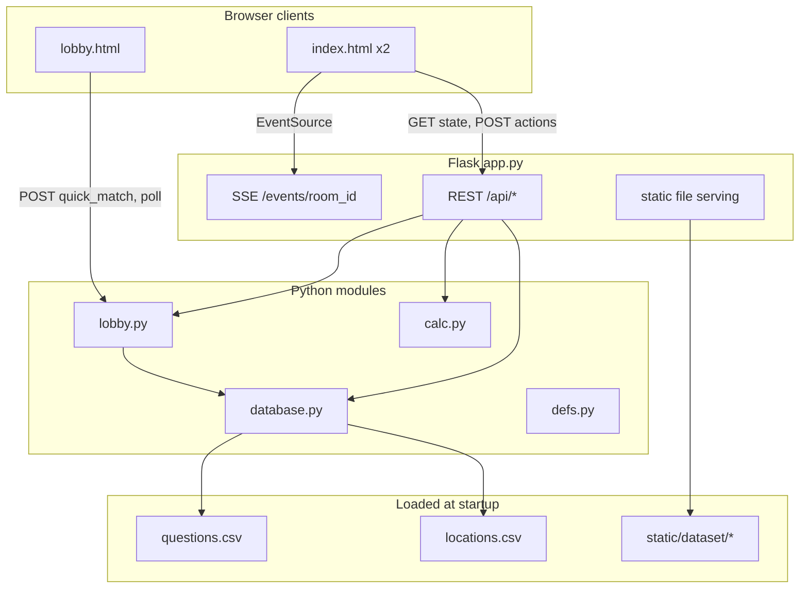
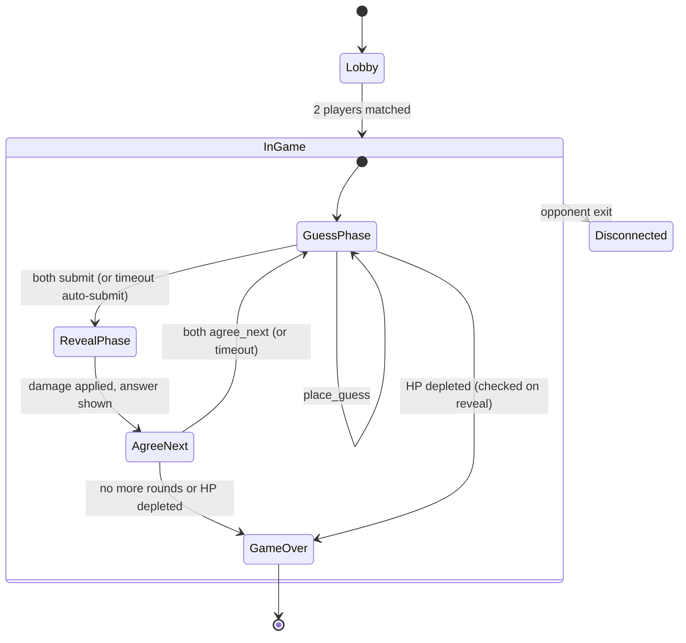

# Reference Codebase Index — `ref/`

This document indexes and summarizes the original **Gensokyo Geo-Guesser** implementation archived under `[ref/](../ref/)`. Use it as the canonical map when designing the revised Neo version on the `dev` branch.

**Original context:** A 2-team competitive web game built for SJTU Touhou Festive 2025. Players view a scene image from Gensokyo, pin a guess on a normalized map, and deal HP damage based on guess accuracy. Public demo was hosted at [ggg.arthas.org](https://ggg.arthas.org).

---

## 1. Directory layout

```
ref/
├── app.py                 # Flask app, REST API, SSE broadcast, game orchestration
├── lobby.py               # Matchmaking (quick match + private rooms)
├── database.py            # In-memory room state + CSV data loading
├── defs.py                # Types, constants, samplers, tunable hyperparameters
├── calc.py                # Distance / damage math
├── requirements.txt       # flask, pydantic
├── README.md              # User-facing rules, deploy guide, credits
├── .gitignore
│
├── data/
│   ├── locations.csv      # Location name → normalized (lat, lon) coords
│   ├── questions.csv      # Question catalogue (image, location, category, comment)
│   └── extract_locs.py    # One-off helper: extract unique locations from questions
│
├── static/
│   ├── index.html         # Main game UI (single-file HTML/CSS/JS, ~728 lines)
│   ├── lobby.html         # Lobby / matchmaking UI
│   ├── media/
│   │   ├── map.jpg            # Playable Gensokyo map (MC幻想乡)
│   │   ├── ref_map.jpg        # Annotated reference map overlay
│   │   └── lobby_background.png
│   └── dataset/           # ~65 question scene images (PNG/JPG)
│
└── tester/
    └── concur_test.py     # Playwright stress test for lobby matching (10 users)
```

### Scale (approximate)


| Asset                              | Count                          |
| ---------------------------------- | ------------------------------ |
| Named locations (`locations.csv`)  | 41                             |
| Questions (`questions.csv`)        | 64                             |
| Dataset images (`static/dataset/`) | 65                             |
| Question categories in use         | 1 (`E` = official games/manga) |


---

## 2. Architecture overview

Monolithic **Flask** server with **no database persistence**. All game state lives in process memory (`database.rooms`). The frontend is **vanilla HTML/CSS/JS** served as static files — no bundler, no framework.




### Concurrency model

- **Lobby:** `threading.Lock` (`lobby_lock`) guards match queues and room status.
- **Per-room:** `threading.Lock` on each `RoomState` via `@room_lock_guard`.
- **Sync:** Server-Sent Events (SSE) per room notify clients to `fetchState()` on `reveal` / `next_round` / `opponent_left`.
- **Not WSGI-safe:** README notes async/multithreading design is incompatible with typical WSGI workers; runs via `app.run()` directly.

---

## 3. Module reference

### `defs.py` — configuration & types

Central tuning knobs and shared types.


| Symbol                        | Role                                                                           |
| ----------------------------- | ------------------------------------------------------------------------------ |
| `Team`                        | Enum: `Blue`, `Red`                                                            |
| `Coord`                       | `Tuple[float, float]` — normalized map coords in **[0, 1]** (lat = y, lon = x) |
| `Question`                    | Pydantic model: `image_path`, `location`, `category`, `comment?`               |
| `max_rounds`                  | `16`                                                                           |
| `max_hp`                      | `100.0`                                                                        |
| `place_guess_timeout`         | `30` s (guess phase)                                                           |
| `agree_next_timeout`          | `10` s (post-reveal advance phase)                                             |
| `distance_scale`              | `100` — multiplier for Euclidean distance → base damage                        |
| `get_category_sampler(seed)`  | Returns iterable of categories per round (currently all `"E"`)                 |
| `get_question_sampler(seed)`  | Infinite random int generator for question index selection                     |
| `get_dmg_mult_selector(seed)` | Round-indexed damage multiplier: `1.0` × 8 rounds, `2.0` × 4, `4.0` thereafter |


Room seed is derived from `sum(ord(c) for c in room_id)` — deterministic per room ID.

### `database.py` — state & data loading

**Global (shared across rooms):**

- `loc_db: Dict[str, Coord]` — loaded from `data/locations.csv`
- `que_db: Dict[int, Question]` — loaded from `data/questions.csv`

**Per-room `RoomState`:**


| Field                                                       | Purpose                                     |
| ----------------------------------------------------------- | ------------------------------------------- |
| `category_sampler`, `question_sampler`, `dmg_mult_selector` | Question/damage selection                   |
| `que_history: List[int]`                                    | Sampled question global IDs, in round order |
| `round_index`                                               | Current round (0-based internally)          |
| `team_hp`                                                   | HP per team                                 |
| `team_coord`                                                | Latest guess pin per team                   |
| `team_answered`                                             | Whether team submitted guess this round     |
| `team_ready_next`                                           | Whether team agreed to advance after reveal |
| `last_damage_applied_round`                                 | Idempotency guard for HP subtraction        |
| `phase_started_at`                                          | Server timestamp for countdown sync         |


**Key behaviors:**

- `sample_question()` supports two modes: category-filtered random pick, or direct global-ID sampler (category sampler `None`).
- `get_question_at(index)` lazily samples until history is long enough.
- `answer_revealed` is a property: `all(team_answered)`.
- `init_database()` called at import/startup; `init_room(room_id)` creates ephemeral room.

### `calc.py` — scoring

```python
distance = sqrt((x1-x2)² + (y1-y2)²)          # normalized Euclidean
scaled_distance = distance * distance_scale     # default scale 100
damage = scaled_distance * dmg_mult             # per-round multiplier
```

Displayed distance in API = `damage / dmg_mult`.

### `lobby.py` — matchmaking


| Concept         | Implementation                                         |
| --------------- | ------------------------------------------------------ |
| Quick match     | FIFO queue; pairs first two waiters into `room_{uuid}` |
| Private room    | Named room queue; rejects if `IN_GAME`                 |
| Channel ID      | `wait:{uuid}` — client polls `/api/lobby/poll`         |
| Team assignment | First player → Blue, second → Red                      |
| Stale cleanup   | 15 s waiter timeout; ended rooms pruned every 5 s      |
| Room lifecycle  | `EMPTY → MATCHING → IN_GAME → ENDED`                   |


### `app.py` — HTTP surface

Entry: `python app.py [--debug] [--port 5000]`

Responsibilities:

1. Serve `lobby.html`, `index.html`, static assets.
2. Expose game API; `get_state()` is the primary read model.
3. Apply damage on reveal via `apply_damage()`; determine winner via `end_game_condition()`.
4. Broadcast SSE messages to all listeners on a room.

**Debug mode** (`--debug`): verbose logging, exposes admin UI controls (prev/next/reveal, team switch), shows guess coordinates, allows force-reveal without both teams answering.

---

## 4. API index

### Pages


| Route                         | File         | Notes                                         |
| ----------------------------- | ------------ | --------------------------------------------- |
| `GET /`                       | redirects    | Requires `?room=&team=` else → `/lobby`       |
| `GET /lobby`                  | `lobby.html` | Matchmaking entry                             |
| `GET /index.html?room=&team=` | `index.html` | Game client (also served via `/` with params) |


### Lobby


| Method | Path                        | Body                | Response                                     |
| ------ | --------------------------- | ------------------- | -------------------------------------------- |
| POST   | `/api/lobby/quick_match`    | `{ room?: string }` | `{ matched, room?, team, channel }` or error |
| POST   | `/api/lobby/poll`           | `{ channel }`       | `{ matched, room?, team? }`                  |
| POST   | `/api/lobby/cancel_waiting` | `{ channel }`       | `{ ok: true }`                               |


### Game


| Method | Path                | Query           | Body           | Effect                                                |
| ------ | ------------------- | --------------- | -------------- | ----------------------------------------------------- |
| GET    | `/api/state`        | `room`, `team?` | —              | Full game state JSON                                  |
| POST   | `/api/init`         | `room`          | —              | Create room if missing                                |
| POST   | `/api/place_guess`  | `room`, `team`  | `{ lat, lon }` | Set team pin (no-op if already answered)              |
| POST   | `/api/submit`       | `room`, `team`  | —              | Lock in guess; broadcast `reveal` when both submitted |
| GET    | `/api/reveal`       | `room`          | —              | Force reveal (debug) or when both answered            |
| POST   | `/api/agree_next`   | `room`, `team`  | —              | Ready for next round; auto-advances when both ready   |
| POST   | `/api/next_round`   | `room`          | —              | Debug: skip to next round                             |
| POST   | `/api/prev_round`   | `room`          | —              | Debug: go to previous round                           |
| POST   | `/api/exit`         | `room`          | —              | Mark room ended; broadcast `opponent_left`            |
| GET    | `/events/<room_id>` | —               | —              | SSE stream (`reveal`, `next_round`, `opponent_left`)  |


### `/api/state` response shape (key fields)

```json
{
  "round": 1,
  "total_rounds": 16,
  "dmg_mult": 1.0,
  "phase": "guess | agree_next",
  "phase_remaining_seconds": 30,
  "team": "blue",
  "hp": { "blue": 100.0, "red": 100.0 },
  "question_img": "dataset/....png",
  "question_comment": "optional source note",
  "answer_coord": [0.5, 0.9],
  "answer_loc": { "name": "博丽神社", "lat": 0.548, "lon": 0.910 },
  "answer_revealed": false,
  "coords": { "blue": [lat, lon] | null, "red": ... },
  "team_answered": { "blue": false, "red": false },
  "team_ready_next": { "blue": false, "red": false },
  "distance": { "blue": null, "red": null },
  "damage": { "blue": null, "red": null },
  "winner": "blue | red | draw",
  "has_next": true,
  "has_prev": false,
  "debug": false
}
```

Opponent coordinates are hidden until `answer_revealed`. `winner` is set only when the game ends.

---

## 5. Game flow (state machine)




### Phase timers (server-authoritative)


| Phase        | Timeout | Client auto-action on expiry                   |
| ------------ | ------- | ---------------------------------------------- |
| `guess`      | 30 s    | Place pin at `(0.5, 0.5)` if none, then submit |
| `agree_next` | 10 s    | Click "next" (agree_next)                      |


Countdown is driven by `phase_started_at` on the server; client restarts local timer from `phase_remaining_seconds` on each state fetch.

### Win conditions

1. Opponent HP ≤ 0 (tie-break: higher HP wins if both ≤ 0).
2. All rounds played — higher HP wins.
3. Draw if HP equal at end (within 0.1) under round-exhausted or simultaneous knockout.

---

## 6. Data schemas

### `data/locations.csv`

No header. One location per line:

```
<location_name>,<lat>,<lon>
```

- Coordinates are **normalized** to the MC幻想乡 map image (`static/media/map.jpg`).
- `lat` = vertical (0 top → 1 bottom), `lon` = horizontal (0 left → 1 right).
- 41 named places (博丽神社, 红魔馆, 永远亭, etc.).

### `data/questions.csv`

No header. 4 or 5 columns:

```
<global_id>,<image_filename>,<location_name>,<category>[,<comment>]
```

- `image_filename` resolved under `static/dataset/`.
- `location_name` must exist in `locations.csv`.
- Current dataset: all category `E` (official); comments cite source work (game ED, manga chapter, etc.).

### `data/extract_locs.py`

Utility script (not part of runtime): reads `questions.csv`, writes unique location names to `locs.txt`. Useful when expanding the question set.

---

## 7. Frontend summary

### `static/lobby.html`

- Single card UI over `media/lobby_background.png`.
- Optional Room ID; blank = quick match.
- Flow: `POST /api/lobby/quick_match` → poll every 1 s → `POST /api/init` → redirect to `/index.html?room=&team=`.
- Cancel waiting + `sendBeacon` on page hide.

### `static/index.html`

Single self-contained page (~728 lines). Layout:


| Region | Content                                                                                         |
| ------ | ----------------------------------------------------------------------------------------------- |
| Left   | Interactive map (`map.jpg`) + SVG overlay for guess→answer lines                                |
| Right  | Round/HUD, damage multiplier, reference map button, submit/next, question image, HP/damage grid |


**Client state:** `room` + `team` from URL query (team is session-locked in production; debug allows switching).

**Map interaction:** Click → normalized `(lat, lon)` → `POST /api/place_guess`.

**SSE:** Listens on `/events/{room}`; refreshes state on `reveal` / `next_round`; shows disconnect modal on `opponent_left`.

**Reference map:** Modal overlay using `media/ref_map.jpg` (labeled map for player aid).

**Debug-only controls:** prev/next round, force reveal, team select buttons, guess coordinate display.

---

## 8. Dependencies & runtime

```
flask
pydantic
```

**Dev/test (not in requirements.txt):** Playwright + asyncio for `tester/concur_test.py`.

**External assets:** Map credit to MC幻想乡 circle (acknowledged in UI).

---

## 9. Known limitations (relevant for Neo rewrite)


| Area              | Current behavior                                                         | Rewrite consideration                                 |
| ----------------- | ------------------------------------------------------------------------ | ----------------------------------------------------- |
| Persistence       | All state in RAM; server restart loses games                             | Decide if rooms/sessions need Redis/DB                |
| Scale             | Tested ~10 concurrent lobby connections on 2-core CPU                    | May need queue service for larger events              |
| Matchmaking       | Naive FIFO pairing; odd waiter stays queued                              | N-player / spectator modes were a stated future goal  |
| Frontend          | Monolithic inline JS/CSS                                                 | Component framework, shared types with backend        |
| Auth              | None; room ID is the only access control                                 | Optional for private tournaments                      |
| Testing           | One Playwright concurrency script                                        | Unit tests for damage/sampling; API integration tests |
| Deployment        | `flask run` / `app.run()` only                                           | WSGI/ASGI strategy if moving to production workers    |
| i18n              | English UI; Chinese location names & comments                            | Locale strategy for Neo                               |
| Question pipeline | Manual CSV + image files                                                 | Tooling for dataset curation                          |
| Dead code         | `index.html` references `/api/ack_refresh` (not implemented in `app.py`) | Clean up or implement                                 |


---

## 10. File → responsibility quick index


| File                    | Lines (approx.) | Responsibility                                                 |
| ----------------------- | --------------- | -------------------------------------------------------------- |
| `app.py`                | 438             | HTTP routes, SSE, damage application, game end logic           |
| `database.py`           | 278             | CSV load, room registry, question sampling, per-room mutations |
| `lobby.py`              | 196             | Match queues, room status, pairing                             |
| `defs.py`               | 49              | Constants, samplers, `Question` model                          |
| `calc.py`               | 17              | Distance and damage formulas                                   |
| `static/index.html`     | 728             | Full game client                                               |
| `static/lobby.html`     | 136             | Matchmaking client                                             |
| `tester/concur_test.py` | 146             | Lobby load test                                                |


---

## 11. Suggested Neo starting points

When building the revised version on `dev`, these reference areas are the functional core to reimplement or deliberately replace:

1. **Coordinate system** — Keep normalized `[0,1]²` mapping to `map.jpg` unless the map asset changes.
2. **Question/location data model** — `locations.csv` + `questions.csv` schemas are battle-tested; can migrate as-is or evolve to JSON/SQLite.
3. **Round loop** — Guess → reveal → damage → agree → next is the proven UX; timers and auto-submit behavior should be preserved or explicitly redesigned.
4. **2-player sync** — SSE + polling fallback pattern works; consider WebSockets if bidirectional traffic grows.
5. **Tunables in `defs.py`** — `max_rounds`, HP, timeouts, samplers, damage curve are the primary game-design knobs.

The full original user documentation (rules, credits, deploy steps) remains in `[ref/README.md](../ref/README.md)`.

---

## 12. Neo design documents

| Document | Scope |
|----------|-------|
| **[neo-design.md](neo-design.md)** | Master framework: goals, decisions, open questions |
| **[design-lobby.md](design-lobby.md)** | Lobby UI, matchmaking state machine, Redis, Lobby SSE/REST |
| **[design-game-rules.md](design-game-rules.md)** | In-game phases, damage plugins, win/rank, AFK, config |
| **[design-game-ui.md](design-game-ui.md)** | In-game layout, leaderboard, pins, spectator, debug UI |
| **[design-game-network.md](design-game-network.md)** | In-game REST/SSE, `state_version`, SyncScheduler |

Use this index for the reference implementation under `ref/`; use the Neo docs above for the `dev` branch rewrite.